For the past year, the same line keeps coming up about coding agents: it's not the model that matters, it's what's built around it — the rules, tools, and memory bolted on top. The industry calls this the harness. I decided to test the claim with real work instead of benchmark scores — and found no quick, clean win for the harness.

Here's the scale of how loud that claim is. SWE-bench is the standard test for coding agents: a set of real issues from open-source projects that the agent has to close with code changes, with the result checked automatically by the project's own existing tests — pass or fail, no room for argument. On this benchmark, the same Claude 3.5 Sonnet with different scaffolding solved anywhere from 168 to 317 tasks out of the same set — a spread of almost 30 percentage points. That's wider than the spread across the entire top-30 of that same leaderboard, agents running on completely different models (8.8 points). Another paper makes the same point more directly: model and task held fixed, only the scaffolding changed — the share of fully solved tasks rose from 25% to 43% (43 to 72 out of 169). Numbers like that are easy to repeat without checking.

## TL;DR

- Took three agents (Claude Code, Hermes, DeepSeek Harness/dsh), ran each one on the same nine tasks twice — with harness and without, model held fixed — 54 runs total.
- Quality didn't move once, anywhere it could actually be measured. Whatever the harness is buying, it isn't a better result.
- The harness's effect on spend splits into three distinct effects: one shared by all three agents (depends on the task's genre), one that's a property of a specific agent-task pairing (and can flip direction entirely), and one where it's just paying more for nothing.
- The agents differ from each other, independent of the harness, by at least as much as the harness itself changes things — sometimes more: Hermes's repeat-run spread (up to 9.3×) outsizes the single loudest harness effect in the whole experiment.
- At the same price, no single agent wins on both cost and quality at once.
- All the measurement code is open: [`workain/agent-runtime-instruments`](https://github.com/workain/agent-runtime-instruments) (Apache-2.0). All 54 measurements, the task list, and the methodology are fully open too, including everything that didn't make it into this piece: [`workain/research-results`](https://github.com/workain/research-results/tree/main/2026-11_harness-agents) (CC BY 4.0).
- This is part 1 of a series. There won't be an open verdict of "you need a harness" or "you don't" — part 2 takes the harness apart into its pieces.

I took three agents and ran each one on the same nine tasks twice — with the harness, and on bare settings with not a single hint added on top:

- **Claude Code** — a terminal coding agent from Anthropic.
- **Hermes** — another agent in the same class, with its own way of wiring up tools and storing settings.
- **DeepSeek Harness** (hereafter dsh) — an agent with a plugin-oriented architecture: almost everything in it, from memory to tools, is wired in through a separate plugin rather than built in up front. Despite the name, that's the product's own name, not our term "harness."

> **Definition.** In this piece, **harness** means three specific things handed to an agent on top of its stock setup: a rules file, a set of tools, and memory carried between the steps of one task. "With harness" and "without" in every comparison below means exactly that and nothing more — the model and the task's wording are identical within each pair of runs.

All three pick up the harness — but each in its own format, not as three independently invented versions. The content (which rules, which tools, what to remember) was the same single set of instructions for all three; where and how that set is physically placed is specific to each agent: for Claude Code it's a CLAUDE.md file, which it reads on its own built-in convention; for Hermes and dsh it's their own equivalent (a rules file / system prompt for Hermes, a plugin for dsh), into which the same set of instructions was translated to fit their format. The difference between "with harness" and "without" is whether that set exists at all, not a difference in what each agent was actually given to read.

These three agents are built differently at a structural level too — where each one's model choice lives, how rules, tools, and memory get wired in:

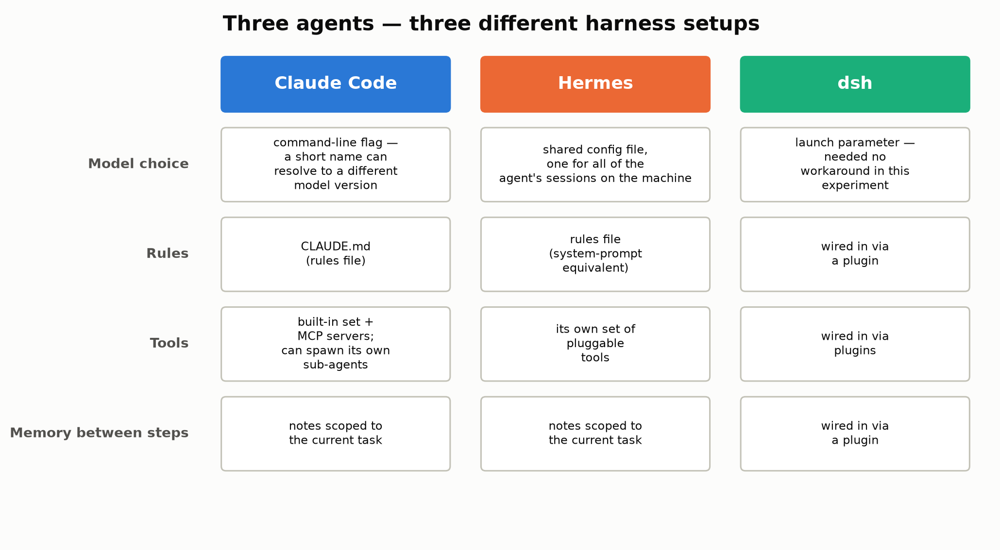

This question actually splits into two independent axes — and neither one here is a footnote to the other:

- **Axis 1 — the agents, on their own.** Regardless of whether the harness is on: how predictably does the agent behave on a repeat run, can you trust what it reports about its own cost, what does it gain from switching models, does it even manage the task at the same price its peers do.
- **Axis 2 — the harness effect.** What changes for the same agent when rules, tools, and memory appear on top of its stock setup — and whether that change is the same across all three.

Across the three of them, the agents behave so differently that this difference often outweighs whether the harness is on or off — with numbers and charts, that's ahead in the axis 1 section.

## The big picture, before diving into detail

Before breaking down which effect shows up on which task and why — here's what all 54 runs look like at once, with no split into individual cases. This is the direct answer to "which agent on average consumes less while working better and cheaper," if one table can even give that answer:

| Agent | Total tokens (54 ÷ 3 = 18 runs per agent) | Total model requests (iterations) | Quality, summed over the 3 tasks where the rubric fired at all (out of 8 = 2 for T2 + 2 for G + 4 for J — what these tasks are, below; identical with and without harness) |
| --- | --- | --- | --- |
| Claude Code | 92,752,468 | 562 | 2 |
| dsh | 84,027,595 | 721 | 3 |
| Hermes | 43,311,328 | 396 | 1 |

No agent wins on both price and quality at once. Hermes is the cheapest by tokens — and the worst on quality, anywhere quality was visible at all. dsh scores the most points on the rubric — but it isn't the cheapest. Claude Code is the most expensive by tokens at middling quality. "Speed," meaning wall-clock seconds, was deliberately left out of this table: part of the measurements ran on a shared machine under load, so seconds in this experiment aren't a standalone metric — the number of requests (iterations) is an honest substitute, one you can check independently of whatever else was happening on the machine at measurement time.

This is an aggregate across all nine tasks at once, not a typical task — and two of the nine (building a feature from scratch, and migrating checks between environments) outweigh the other seven combined in total tokens. So what follows is not just what's hiding behind one averaged row, but why it's averaged in the first place:

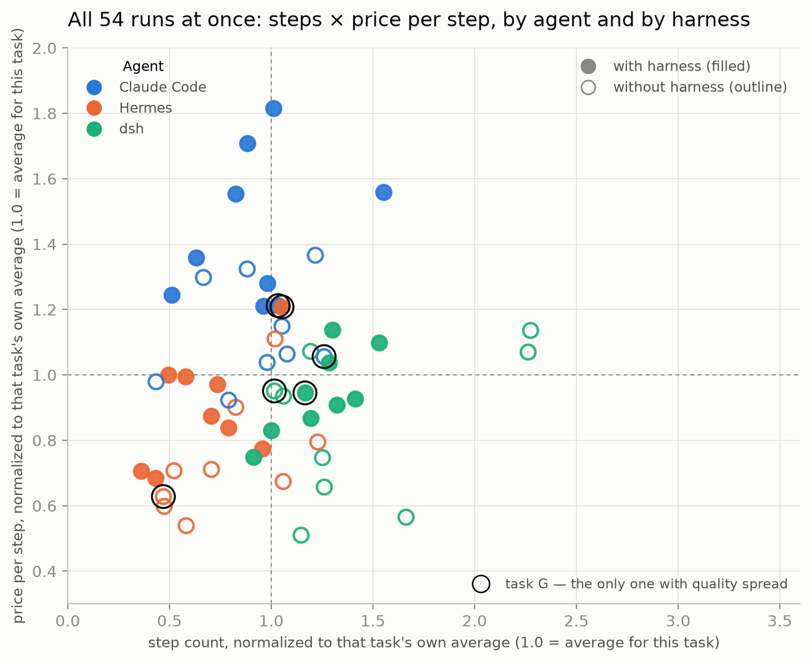

Each point is one run (nine tasks × three agents × two modes). The X axis is the agent's number of steps on that task; the Y axis is the price of one step; both values are normalized to that same task's own average, so tasks of different scale stay comparable on one chart. Color is the agent; filled means harness on, outlined means off. Three things are visible at once: first, dsh (green) has the widest spread on the X axis of the three — it sometimes takes noticeably fewer, sometimes noticeably more steps than the average task of that type. Second, Hermes (orange) lives mostly to the lower-left of the others — fewer steps, cheaper per step, matching its spot in the summary table above. Third, task G's six points (circled in black; what task G is comes in the next section) are scattered across the whole plot rather than clustered together — even though this is the one task where quality actually moved (0, 1, or 2 out of 2), that difference is invisible from this chart's position alone (steps/price): effort and outcome are not the same thing, and we'll come back to that.

## Nine tasks: what was actually asked

Three agents — Claude Code, Hermes, and dsh — went through the same set of nine tasks, each one twice. Here are all nine, with the real wording, not just a letter:

| Task | Origin | Genre | What was actually asked | Scored? |
| --- | --- | --- | --- | --- |
| T1 | built for the test | investigate | Go through the internal knowledge base and prior working notes and report what's known about where exactly the measurement breaks — recurring failure types, specific numbers, what changed over time. | no (didn't reach scoring this round) |
| T2 | built for the test | build (fixes something existing) | Decide whether a specific pre-commit check can actually fire on failure, and if not — fix it in the repo: show both a correct failure and a correct pass. | yes — out of 2, exactly 1/2 in all six scored runs (three agents × two modes) |
| T3 | built for the test | investigate | Explain a sharp jump in a detection-time metric (from near-zero to hundreds of hours) — is this a real degradation or a measurement artifact, and what should be watched instead. | no |
| F | real work | investigate | Investigation against a frozen, read-only snapshot: why several sessions crashed at the same time, whether it was the same event, and whether any monitoring even noticed — no attempt to fix anything. | no |
| M | real work | investigate | A real plan for migrating a workload to another agent: what moves, what can't, what breaks unattended, what it costs, what breaks on day one. "Don't migrate" is an acceptable answer. | no |
| S ("measurability") | real work | investigate | Assess how severe a real measurability regression actually is (some records confuse branches, some links barely match), find the cause, say what fixes it. | no |
| G | real work | build (fixes something existing) | Migrate three checks (precommit/scanning) from one trigger mechanism to another, showing for each a test that fails before the change and passes after. | **yes — the only task with any spread: 0/2, 1/2, or 2/2 depending on the agent** |
| H ("build from scratch") | real work | build (from scratch) | Build a fleet-session statistics tool from scratch: requests, tokens by type and cache TTL, time, price, context size — run it on real data and plainly state what the tool can't see. | no |
| J (independent answer key) | real work | investigate | Review a specific pull request and report its blocking defects so they can be reproduced, plus explicitly name what it got right. Scored against an independent list of this PR's real defects, drawn up in advance by a human — not to the reviewer's own taste. | yes — out of 4, exactly 0/4 in all six scored runs (three agents × two modes) |

"Built for the test" tasks (T1–T3) aren't abstract toys with no context: T1 and T3, for instance, operate on entirely real repository content. What sets them apart is that they were specifically constructed for this kind of run, rather than being work that needed doing independent of whether anyone was measuring it — unlike the six "real" tasks (F, M, S, G, H, J), which existed on their own.

The genre split ("build" / "investigate") is a separate cut, one that doesn't line up with origin: the very same T2, G, and H make up the "build" genre (the one criterion being whether the task's wording demands an actual change to the repo), and this split was noticed from the data after the fact, not set in advance.

Of the nine tasks, the rubric measured anything at all on three — T2, G, and J (hence the "out of 8" in the summary table above: 2 for T2 + 2 for G + 4 for J). Among them, only one showed any spread from the harness:

- **G** (the only one with spread) — each agent's score matched across both harness states: the harness didn't change the outcome for any of the three (table and chart below, in the axis-2 section).
- **J** (out of 4) — no agent, in any of the six runs (three agents × two modes), gave a correct answer. The score was exactly zero across the board. There was nothing for the harness to move here: the outcome was already floored for all six.
- **T2** (out of 2) — the same average score across all six runs. The rubric technically fired, but distinguished nothing: neither the harness nor the agent affected anything here, at least by this rubric's own yardstick.
- **The remaining six tasks** — no formal quality score was built for them this round at all. That's explicitly marked as "not measured," not invented after the fact.

Whenever a scoring table comes up below, the number after "out of" is the reference, maximum-possible count — not a count of files or steps, which has no "correct" value to begin with. Whatever the harness is paying for, it isn't the quality of any individual answer, anywhere that could actually be seen.

The full list of all 54 measurements (not just the ones that made it into this piece), with methodology and detail, is in the open dataset: [`workain/research-results`](https://github.com/workain/research-results/tree/main/2026-11_harness-agents).

## How it was measured, briefly

The model was held fixed within every cross-agent comparison — otherwise comparing agents turns into comparing model prices. Keeping it fixed took separate work of its own (for some agents the model choice is a launch parameter, for others a setting in a shared config file), and price everywhere was recalculated from the provider's own billing record, not from whatever the agent reports about itself — because self-reports, for some agents, turned out not to be trustworthy as-is (detail in the axis-1 section and in the open methodology). The full engineering story is in the dataset's [`methodology.md`](https://github.com/workain/research-results/tree/main/2026-11_harness-agents/methodology.md); it isn't repeated in detail here, so as not to clutter the piece with the measurement's own internal kitchen.

One limit to keep in mind through the whole piece: every number below is the result of a single run (n=1), not a statistical test. Read it as "this is what happened," not as an exact constant — there's never more than one run behind any "roughly" or "around" in the wording below.

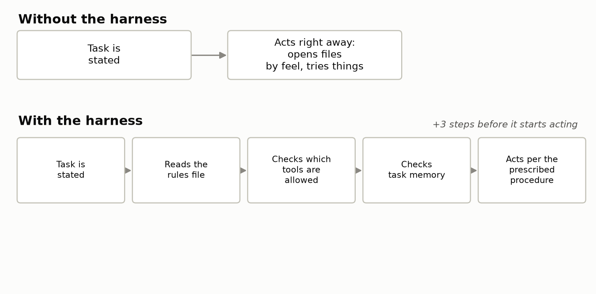

## Axis 1: the agents, on their own

Here the harness is held the same across all three — on for everyone or off for everyone — and we look at how the agents differ from each other on their own. This axis matters just as much for a practical decision as the harness effect in the next section: if the spread between agents is bigger than the effect of switching the harness on, then "which agent" matters more than "with harness or without."

### Repeat runs: does an agent agree with itself

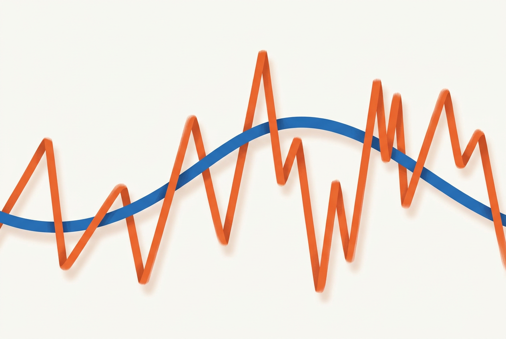

The same task, on the same setup, was run twice without changing a single line in the harness, to see how far the repeats would drift apart:

- **Claude Code** — ≈1.2×, barely noticeable.
- **dsh** — from 1.75× up to at least ≈3.5× (the upper bound isn't closed: more runs could show an even wider spread).
- **Hermes** — up to 9.3×: an ordinary repeat can differ from the previous run by almost an order of magnitude.

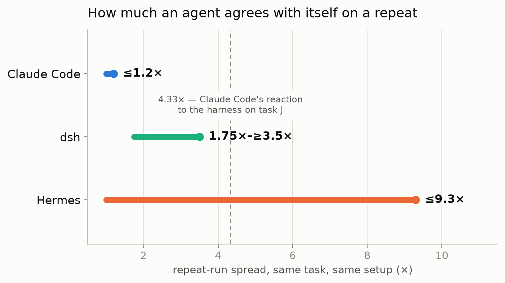

The harness has nothing to do with this — it's an agent's own reproducibility: how differently it solves the same task under the same conditions, simply from one time to the next. Two facts the chart makes legible: first, the spread between agents is an order of magnitude, not a matter of percentage points (from ≈1.2× for Claude Code to ≈9.3× for Hermes). Second, Hermes's ceiling (9.3×) is higher than the single loudest harness reaction anywhere in the experiment — Claude Code's 4.33× on task J (the dashed line on the chart). Any difference we attribute to the harness for Hermes specifically, below, has to be checked against this background noise first: an effect smaller than the noise isn't an effect yet.

This has a direct practical consequence for how agents normally get compared. Run Hermes on a task once and get a number; a second identical run, with not a single setting changed, can come out almost nine times different — purely from the agent's own nature, no harness involved. A team that compares two agents on one run each (a common practice, not a mistake unique to this piece) risks ending up with a ranking that's entirely explained by where, exactly, that particular Hermes run landed inside this ninefold spread — not by which agent is actually better.

### Whose self-report can you trust

Trusting what an agent says about its own cost turned out to be a property of the specific agent too, not a general rule:

| Agent | What's wrong with the self-report |
| --- | --- |
| Claude Code | three of its own token counters under one name, up to ≈25× apart from each other on tasks involving sub-agents |
| Hermes | its "input tokens" after the fact conflate fresh and cached tokens — up to ≈10× price discrepancy on the affected cells |
| dsh | its component-recalculated price and the provider's independent billing matched almost exactly across all 18 of its runs |

For Claude Code, delegation is a routine part of the job: on a complex task, the main conversation can hand off a chunk of work to a separate sub-agent with its own, separate token count, one that isn't always visible in the same place as the main conversation's count. On tasks where Claude Code spawned such helpers, one of its counters showed almost 25 times more tokens than the other — even though both print under the same label, "how much I spent." If you're watching the number an agent prints about itself in production, for Claude Code it's worth first figuring out which one of them you're actually reading — a budget calculated from a session with no sub-agents will silently blow through on the very first task where the agent decides to delegate part of the work.

Claude Code also turned up a separate bug, different in nature: for one model version, its own internal price table was simply missing a row — and the agent, finding no rate, calculated a single run's cost at roughly 50 times the real one (per the provider's billing). This isn't a discrepancy between its two counters like the example above, but a missing row in a price list: the same class of error as Hermes's in the table above, just with a different mechanism and on the opposite end of the scale (50× more expensive, not cheaper).

All three were checked with the same method — the difference isn't in the checking method, it's in what that method actually found. This, too, is a decision that has nothing to do with the harness: which agent is worth cross-checking against an independent count at all, and which can (for now) be trusted — that's a question about the specific agent, and the answer is different for all three.

### Switching to a cheaper model

All three were moved from the expensive version of a model to the cheap one from the same lineup:

- **Claude Code** — the bill on the same tasks drops ≈9×.
- **Hermes** — drops ≈56×.

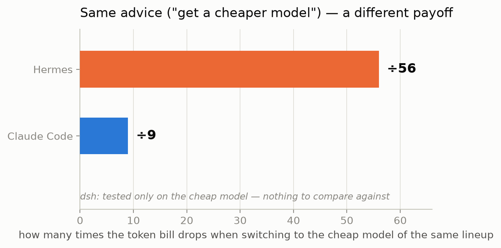

The advice "just take a cheaper model" pays off multiple times harder for one agent than the other — on the chart, the gap between them is more than sixfold (56÷9 ≈ 6.2). What decides this isn't the rate card, it's the agent's own architecture: how many times it calls the model along the way, and how much context it rereads from cache instead of resending it fresh. Cache is billed as a separate line and priced differently from a fresh token — which means for an agent with a high share of cache reads, switching from the expensive model to the cheap one hits the bill in two places at once: both the fresh token and the cache read get cheaper. For an agent that barely uses cache, only the first part of the bill improves, and the bulk of it is priced at the full fresh-token rate regardless — so the payoff is smaller.

### Is the cheap model even enough

On task G, with the same cheap model for everyone:

- **dsh** (tested only on the cheap model) — saw it through, full score: 2 out of 2.
- **Claude Code** — 1 out of 2, half as good as on its usual, more expensive version (2 out of 2 there, on the same task).
- **Hermes** — 0 out of 2, didn't change a single file in the project in either of the two runs.

The harness was switched on identically for all three in this comparison — the difference here is between agents, not from the harness.

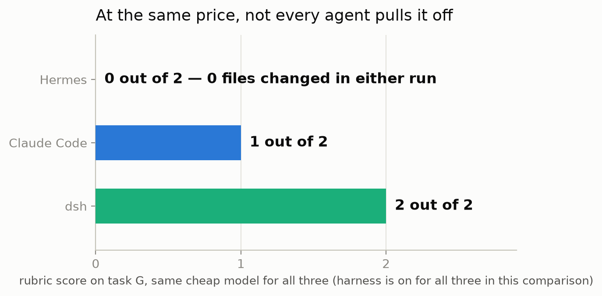

This isn't about the harness and it isn't about luck — it's about whether the agent can handle the task at all at the price you're willing to pay. The harness won't pull off a task the agent simply can't do on that model: below, in the axis-2 section, the same task G comes back again — this time to show that the harness doesn't even try to compensate for this, it just costs more.

Summed up, across this whole battery of tasks, independent of the harness:

| Agent | Repeat-run spread | Price change on switching to the cheap model | Score on the cheap model (out of 2) |
| --- | --- | --- | --- |
| Claude Code | ≈1.2× | drops ≈9× | 1 |
| Hermes | up to ≈9.3× | drops ≈56× | 0 — 0 files in both runs |
| dsh | 1.75×–≥3.5× | tested only on the cheap model, nothing to compare against | 2 |

All of this — repeat-run spread, trust in self-reporting, the price of switching to a cheap model — exists separately from the harness, and is worth knowing in its own right before picking an agent. But the experiment's question was about the harness, and we can now go back to it with this background in mind: from here on, every "harness effect" number is read against what's already known about the agent itself, not in a vacuum.

## Axis 2: the harness effect

Here, the other way around, the agent is held fixed and we look at what switching the harness on changes. Three effects turned up, each of a different order: one depends only on the task's genre and is the same across agents; a second depends on the agent-task pairing and can flip into the opposite direction; a third is the case where the harness doesn't change the outcome at all, it just costs more.

### Effect one: task genre, the same for everyone

The first harness effect is predictable, and it doesn't depend on which agent you pick.

If you count steps instead of tokens, the rule comes out clean. On "investigate" tasks, the harness reliably cuts steps: on average the agent needs only 0.84 of what it would have taken without any hints. On "build" tasks, it's the opposite — on average, 1.16 times more steps. This isn't a one-off pattern: it holds for Claude Code, Hermes, and dsh all at once, with the same model for all three.

The mechanics aren't complicated: on "investigate" tasks, an agent with no hints burns moves feeling out the path — opening the wrong files, re-checking guesses; the harness points the way in advance, and there's no wandering to do. On "build" tasks, the agent is already getting straight to work — there's new code to write, not much to wander around in; here the harness adds its own procedure (check the requirements, go through a checklist), and that procedure costs extra moves that wouldn't otherwise be needed.

Two tasks are worth naming directly — the pattern shows up on them harder than on the rest, with no exception across all three agents: on "measurability" (S), all three agents cut their step count under the harness; on "build from scratch" (H), all three increased it.

From here it gets more complicated. The price of a single step barely depends on task type — the same measurement, but for one model call instead of their count, comes out nearly identical across both genres:

| Task genre | Steps, with harness ÷ without | Price per step, with harness ÷ without |
| --- | --- | --- |
| "Investigate" | 0.84 | 1.17 |
| "Build" | 1.16 | 1.14 |

Steps diverge noticeably by genre; the price per step, almost not at all. It turns out the harness changes how many times the agent acts, and barely changes what one action costs. The total token bill is the product of these two quantities, and they don't always pull the same way.

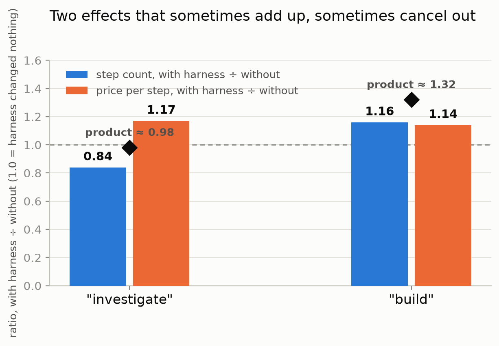

Multiply them, and the difference becomes concrete — that's what the diamonds on the chart show. On "build": 1.16 steps × 1.14 price-per-step ≈ 1.32 — the two effects pull the same way and reinforce each other. On "investigate": 0.84 steps × 1.17 price-per-step ≈ 0.98 — here the effects nearly cancel: step count drops noticeably, while price per step rises almost as much, and in the final token bill it looks as if the harness changed nothing at all, even though both quantities moved under the hood, just in opposite directions. A flat "the harness barely changed anything" on one genre and "the harness is noticeably more expensive" on another can be the same pair of underlying effects — just aligned in one case and opposed in the other.

### Effect two: the same switch, in different agents' hands

The second effect is far more temperamental: it depends not just on the task, but on who the harness landed with — and sometimes it flips into the opposite direction entirely.

This shows up on the independent-answer-key task — that same J. Its genre is "investigate": the agent needs to gather facts and give a checkable answer without touching the code. For Claude Code, switching the harness on raised token spend almost 4.3×: the harness's rules require going through specific verification steps before giving a final answer, and for this agent each such step turned out surprisingly heavy, with large chunks of text going in and coming out. For Hermes, on the exact same task, flipped with the exact same switch, tokens didn't rise — they dropped to a quarter of what they were: the same set of rules, for this agent, apparently helped it cut a shorter path rather than lengthening it. For dsh, on the same task, the harness also nudged spend up slightly — by 1.57× — landing right between these two extremes: no spike like Claude Code's, no drop like Hermes's.

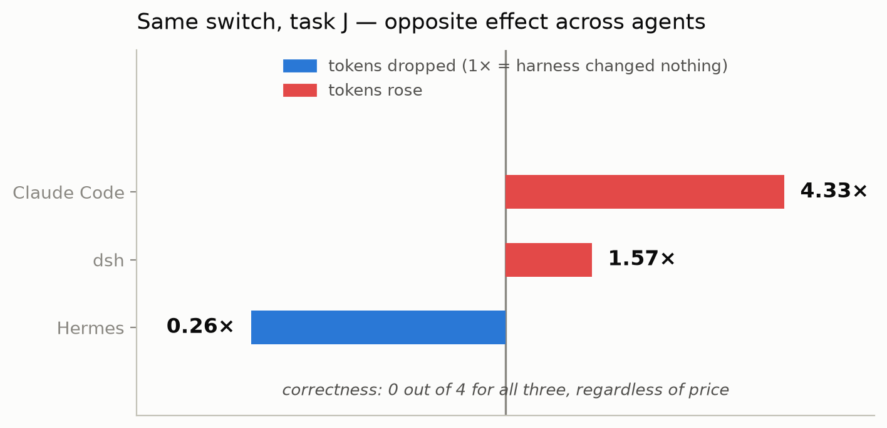

The range between the two extremes on the chart is 4.33× for Claude Code against 0.262× for Hermes — a 16.5-fold gap between two agents on the same switch, on the same task. And correctness, labeled right on the chart, doesn't fit into that gap at all: no agent, in any of the six runs, gave a correct answer (reference — 0 out of 4 for all six). Whatever Claude Code was buying with its extra tokens, and whatever Hermes was saving, the result was equally zero either way. Tokens diverged by multiples; correctness didn't.

Across the whole picture, each agent reads its own pattern:

| Agent | Pattern across the whole battery |
| --- | --- |
| Claude Code | close to 1× almost everywhere, with exactly two sharp spikes — this task and "build from scratch" |
| Hermes | no calm zones at all, wide spread on almost any task |
| dsh | not a single sharp spike in either direction — the most restrained spread of the three |

For Claude Code, both spikes make sense: one is the task above, the other is "build from scratch" (H) — exactly the genre where the harness is expected to cost more, just noticeably harder for this agent than for the others. On H, with the same model, the harness raises Claude Code's tokens by 3.31× — against 1.34× for dsh on the same task, the same model: a roughly 2.5× gap between the two agents, one that doesn't stand out for dsh precisely because it falls within its own usual manner (below). Hermes's wide spread isn't a surprise: it's already the least predictable of the three with no harness involved at all (see the repeat-run section above), so part of its reaction to the harness is simply its usual manner, pushed to an extreme in both directions. And dsh's 1.57× on J and 1.34× on H aren't a compromise between its neighbors in the table — they're its usual manner: across the whole battery of tasks, it never spikes above ≈2× once, so a moderate reaction here is the agent staying itself, not the harness softening something for it.

So "how an agent reacts to the harness" is a property not of the harness, but of the agent-plus-task pairing. Tuning a harness for a specific tool means tuning it for that character, not in general.

### Effect three: when the harness is just more expensive

The harness doesn't even guarantee "not worse." Here's task G, run on the same cheap model for all three. In every row, the score is identical across both harness states (reference — 2 out of 2; each agent has its own result, but a stable one): the difference here is between agents, not between harness-on and harness-off for one agent.

| Agent | Rubric score (out of 2, identical with and without harness) | Files changed — with harness / without |
| --- | --- | --- |
| dsh | 2 out of 2 | 8 / 5 |
| Claude Code | 1 out of 2 | 5 / 7 |
| Hermes | 0 out of 2 | 0 / 0 — not a single file in either run |

(The number of files changed has no reference value of its own — the rubric scores the outcome against a checklist, not the raw count of edits; files here show effort, not correctness.)

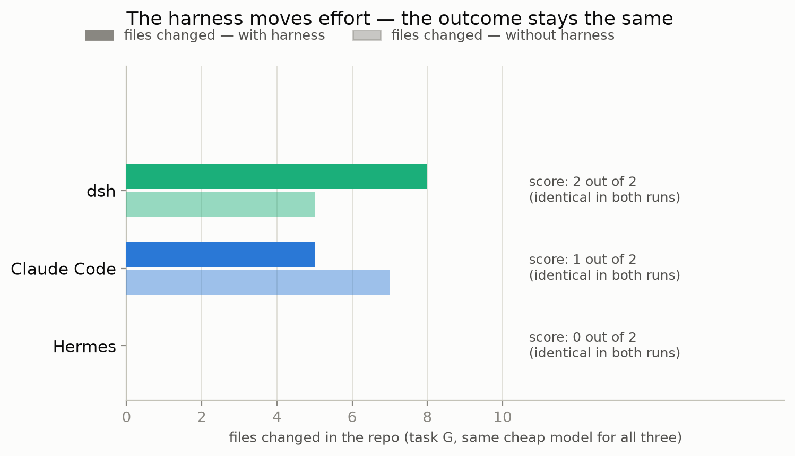

dsh and Claude Code, at this price, at least do something: they change files, move partway through the checklist. The chart shows that for Claude Code the harness even lowers the file count (from 7 to 5) — and this neither hurts nor helps its score, which stays 1 out of 2 either way. Hermes does nothing: the outcome is zero with the harness and without it — neither of the two runs touched a single line. And this is exactly where the harness cost it roughly four times its usual price: the same set of rules that saved Claude Code steps on other tasks here made Hermes re-read the requirements and attempt to check against the checklist several times over — without that leading to any action in the code at all. The outcome was equally zero either way from the start; the harness didn't rescue this attempt, it just made it more expensive. Effort (files, steps, price) and outcome (rubric score) are two different quantities here, and the harness only moves the first one. Why both of Hermes's runs specifically got stuck without reaching a single edit is a separate question this experiment doesn't answer: it's visible that the agent never got as far as changing code either time, but not visible what exactly it got stuck on.

This is the second case in this experiment where price says more than the outcome. On task J, the outcome was equally zero for all three regardless of what was paid. Here, the same thing happens for one specific agent on one specific task: the price differs, the outcome is zero either with harness or without.

## All together: by type of work, one view per agent

One more cut through the same 54 measurements — not by origin, and not by the "build/investigate" genre from the previous section, but by the type of work itself: **analysis** — pure diagnosis with no decision and no code changes (T1, T3, F, S), **management** — planning and an organizational decision (M, a single task), **execution** — anything that requires actually delivering a concrete outcome: changing code (T2, G, H) and a structured checklist review (J).

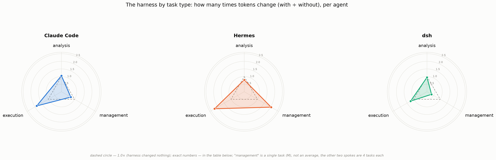

| Agent | Analysis (4 tasks) | Management (1 task) | Execution (4 tasks) |
| --- | --- | --- | --- |
| Claude Code | 1.05× | 0.71× | 1.87× |
| Hermes | 0.78× | 2.03× | 2.24× |
| dsh | 0.94× | 0.34× | 1.24× |

(each number is total tokens with harness ÷ without, summed across the tasks within that type; 1.0× means "the harness changed nothing")

This is visible without recomputing genres: **analysis** is the quietest axis for all three without exception, around 1× (0.78–1.05) — pure diagnosis barely reacts to the harness for any of the three agents. **Execution**, on the other hand, is the most expensive axis for all three (1.24–2.24×) — and this isn't a retelling of the "build" genre effect from earlier: besides the three build tasks, this one also folds in J (the PR review), which is genre "investigate" but, by type of work, is about delivering a concrete, checkable outcome. **Management** flips the whole pattern on its head: here the spread between agents is the wildest in the entire piece (0.34× for dsh against 2.03× for Hermes, almost a sixfold difference) — but this is one single task (M), not an average over several — read this spoke as a hint at character, not a reliable fact about the whole type of work.

A reminder: every number here is the result of a single run (n=1), see the caveat above.

## What to do with this

### On the harness

The main practical takeaway isn't "yes" or "no" — it's that the question itself needs breaking apart:

- Don't ask whether you need a harness in general — ask about your own type of tasks.
- On navigation and investigation, in this sample, it paid off every time — it saved steps.
- On "build from scratch," it came out more expensive every time — budget for that, don't be surprised by the bill.
- Check it on your own agent: the harness effect isn't a universal constant, it's a property of a specific agent-plus-task pairing, and yours might turn out to be the opposite of what worked for your neighbor.

### On choosing an agent

Comparing agents doesn't stop at who has the better harness. It's worth asking separately:

- How predictably does the agent behave on its own — a repeat run of the same task can diverge by multiples.
- Can you trust what it prints about its own spend.
- What it gains from switching to a cheaper model — the gain can turn out far smaller than a competitor's.
- Whether it can handle your task at all at the price you're willing to pay. A harness won't rescue a task the agent simply can't do on that model.

## What's next

There was no quick win for the harness in this test. Nor a single answer to which agent is simply better. What's visible instead: the harness is a trade-off, and the sign of that trade-off changes from task to task and from agent to agent; and the agents themselves differ even without it, often by more than switching the harness on or off decides.

The next step is to stop asking about the harness as a whole and take it apart into pieces: what's the agent's memory in it, what's the set of available tools, what are the connected helpers, what's access to external systems, and what's just the text of the rules. That raises a question: if the effect of the whole harness is this uneven — helps here, hurts there, depends on who got it — is all the benefit (or all the harm) concentrated in one or two items from that list, with the rest just riding along as ballast that gets paid for anyway? And then to see which part is actually pulling its weight, and which one is a free rider. That's part 2.

## Sources

- [Coding Agents Have Converged (2026)](https://arxiv.org/html/2609.17394v1) — the same model on SWE-bench with different scaffolding spreads 29.8 pp; the entire top-30 of the leaderboard, among themselves, spreads 8.8 pp.
- [Same Model, Different Harness: Different Coding-Agent Results (2026)](https://arxiv.org/abs/2608.26218) — model and task held fixed, only the scaffolding changes: the share of fully solved tasks goes from 25% to 43% (43→72 out of 169).
- [`workain/agent-runtime-instruments`](https://github.com/workain/agent-runtime-instruments) — open tooling for honestly measuring the cost of AI agent sessions.
- [`workain/research-results`](https://github.com/workain/research-results/tree/main/2026-11_harness-agents) — the full open dataset and methodology for this experiment: all 54 measurements (including what didn't make it into this piece), the task list with descriptions, the price-recalculation methodology.
