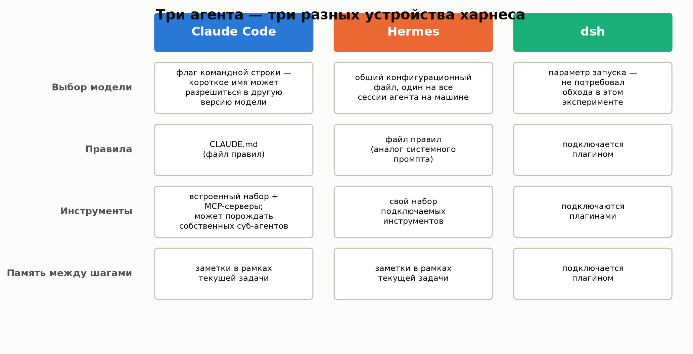
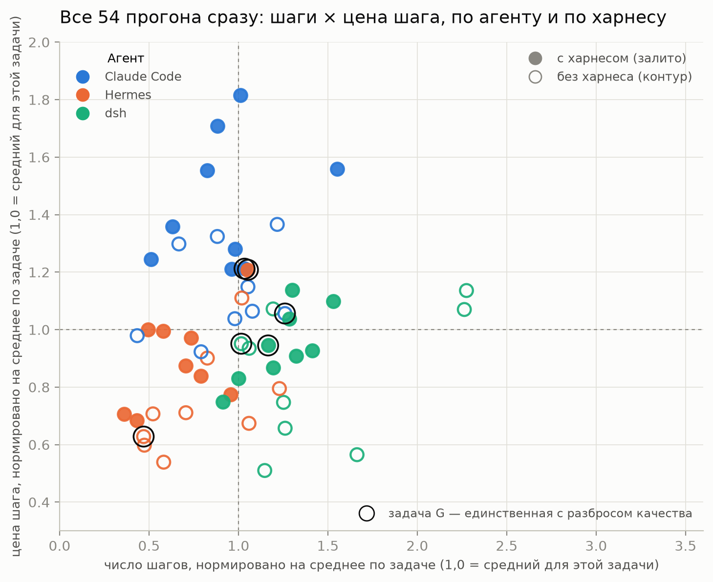
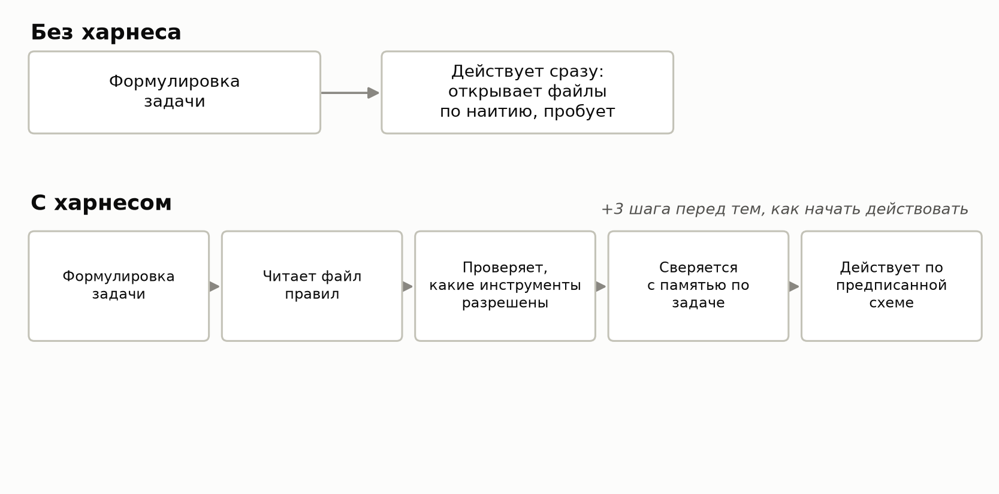
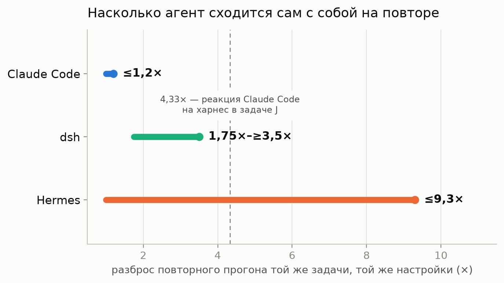
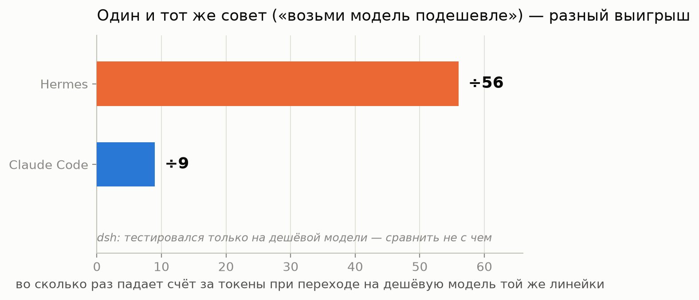
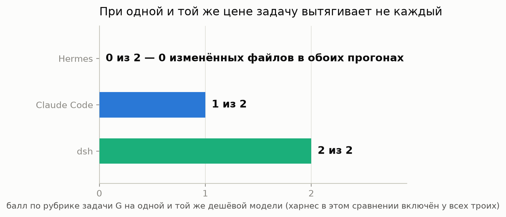
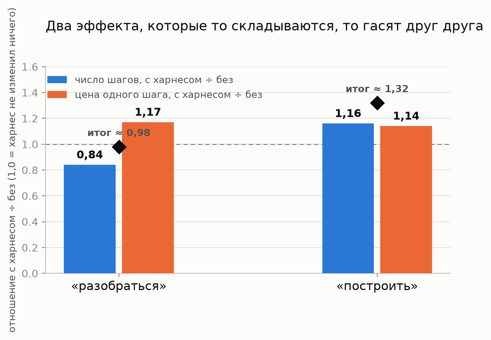
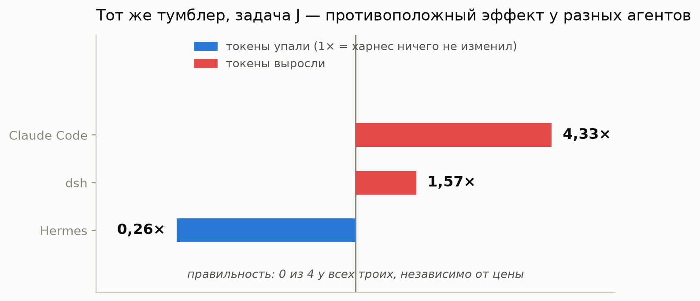
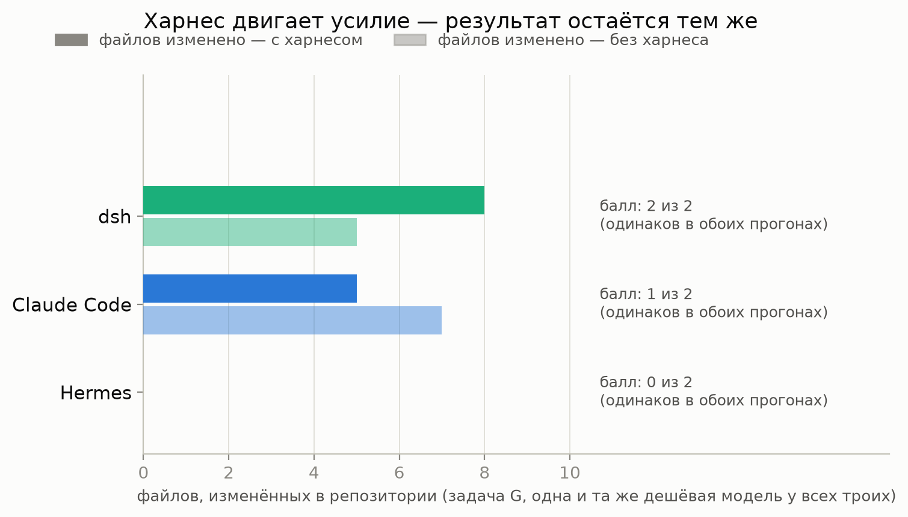
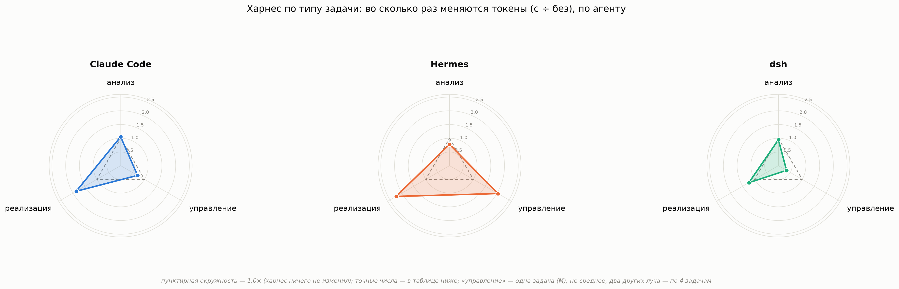

Весь последний год про кодинг-агентов твердят одно: дело не в модели, а в том, что настроено вокруг неё — в правилах, инструментах и памяти, которые на неё навешивают. В индустрии это называют харнесом. Я решил проверить утверждение не баллами теста, а работой — и быстрой, однозначной победы харнеса не нашёл.

Насколько громко твердят — для масштаба. SWE-bench — стандартный тест для кодинг-агентов: набор настоящих issue из открытых проектов, которые агент должен закрыть правками в коде, а итог автоматически проверяют существующими тестами проекта — прошли они или нет, спору нет места. На этом тесте один и тот же Claude 3.5 Sonnet с разными обвязками решил от 168 до 317 задач из одного набора — разброс почти в 30 процентных пунктов. Это больше, чем разброс между всей тридцаткой лидеров того же лидерборда, которые работают на совершенно разных моделях (8,8 пункта). Другая работа показывает то же самое прямее: зафиксировали и модель, и задачу, поменяли только обвязку — доля полностью решённых задач поднялась с 25% до 43% (с 43 до 72 из 169). Такие числа удобно пересказывать, не проверяя.

## TL;DR

- Взял три агента (Claude Code, Hermes, DeepSeek Harness/dsh), прогнал каждого по одним и тем же девяти задачам дважды — с харнесом и без, при зафиксированной модели — 54 прогона.
- Качество не сдвинулось ни разу, там, где его вообще можно было измерить. Харнес, если за что-то и платит, то не результатом.
- Эффект харнеса на расход — три разных эффекта: один общий на всех (зависит от жанра задачи), один — свойство конкретной пары агент+задача (может развернуться в обратную сторону), один — просто переплата без всякого исхода.
- Агенты различаются между собой независимо от харнеса не меньше, чем от его включения — иногда больше: разброс повторного прогона у Hermes (до 9,3×) перекрывает самый яркий эффект харнеса во всём эксперименте.
- При одной и той же цене ни один из трёх агентов не выигрывает сразу по стоимости и по качеству.
- Весь код измерения — открыт: [`workain/agent-runtime-instruments`](https://github.com/workain/agent-runtime-instruments) (Apache-2.0). Все 54 измерения, список задач и методология — открыты полностью, включая то, что не попало в эту статью: [`workain/research-results`](https://github.com/workain/research-results/tree/main/2026-11_harness-agents) (CC BY 4.0).
- Это часть 1 серии. Открытого вывода «харнес нужен / не нужен» не будет — часть 2 разбирает харнес на составляющие.

Я взял трёх агентов и прогнал каждого по одним и тем же девяти задачам дважды — с харнесом и на голых настройках, без единой подсказки сверху:

- **Claude Code** — терминальный кодинг-агент от Anthropic.
- **Hermes** — ещё один агент того же класса, со своим способом подключать инструменты и хранить настройки.
- **DeepSeek Harness** (дальше — dsh) — агент с плагин-ориентированной архитектурой: почти всё в нём, от памяти до инструментов, подключается отдельным плагином, а не встроено заранее. Несмотря на название — это имя продукта, не наш термин «харнес».

> **Определение.** В этом тексте **харнес** — это три конкретные вещи, выданные агенту поверх его стоковой поставки: файл правил, набор инструментов и память между шагами одной задачи. «С харнесом» и «без» в сравнениях ниже значит ровно это и ничего больше — модель и формулировка задачи в каждой паре прогонов одни и те же.

Все трое подхватывают харнес — но каждый в своём собственном формате, а не в трёх независимо придуманных версиях. Содержание (какие правила, какие инструменты, что помнить) было одним и тем же набором инструкций для всех троих; то, куда и как этот набор физически кладётся, у каждого агента своё: у Claude Code это файл CLAUDE.md, который он читает сам по встроенному соглашению; у Hermes и у dsh — их собственный аналог (файл правил/системный промпт у Hermes, плагин у dsh), в который тот же набор инструкций был переведён под их формат. Разница между режимами «с харнесом» и «без» — это наличие или отсутствие этого набора, а не разница в том, что именно каждому агенту дали прочитать.

Устроены эти три агента по-разному и структурно — где у каждого лежит выбор модели, как подключаются правила, инструменты и память:

У этого вопроса на самом деле две независимые оси — и ни одна из них здесь не сноска к другой:

- **Ось 1 — агенты сами по себе.** Независимо от того, включён ли харнес: насколько предсказуемо агент ведёт себя на повторе, можно ли доверять тому, что он сообщает о своей цене, что он выигрывает от смены модели, справляется ли вообще с задачей при той же цене, что и соседи.
- **Ось 2 — эффект харнеса.** Что меняется у одного и того же агента, когда поверх его стоковой поставки появляются правила, инструменты и память — и меняется ли это одинаково у всех троих.

Втроём агенты ведут себя настолько по-разному, что эта разница нередко весит больше, чем включённый или выключенный харнес — с цифрами и графиками это дальше в разделе про ось 1.

## Общая картина, прежде чем нырять в детали

Прежде чем разбирать, какой эффект на какой задаче и почему, — вот как выглядят все 54 прогона сразу, без разбивки на отдельные случаи. Это прямой ответ на вопрос «какой агент в среднем потребляет меньше, а работает лучше и дешевле», если такой ответ вообще можно дать одной таблицей:

| Агент | Токенов всего (54 ÷ 3 = 18 прогонов на агента) | Запросов к модели всего (итераций) | Качество, сумма по 3 задачам, где рубрика вообще сработала (из 8 = 2 по T2 + 2 по G + 4 по J — что это за задачи, ниже; одинаково с харнесом и без) |
| --- | --- | --- | --- |
| Claude Code | 92 752 468 | 562 | 2 |
| dsh | 84 027 595 | 721 | 3 |
| Hermes | 43 311 328 | 396 | 1 |

Ни один агент не выигрывает сразу по цене и по качеству. Hermes дешевле всех по токенам — и хуже всех по качеству там, где качество вообще было видно. dsh набирает больше всего баллов по рубрике — но не он самый дешёвый. Claude Code — самый дорогой по токенам при среднем качестве. «Скорость» в значении секунд в эту таблицу сознательно не вошла: часть замеров шла на общей машине под нагрузкой, так что секунды в этом эксперименте — не самостоятельная метрика, а число запросов (итераций) — честная замена, которую можно сверить независимо от того, что происходило на машине в момент замера.

Это агрегат по всем девяти задачам сразу, а не по типичной задаче — и две задачи из девяти (построение фичи с нуля и перенос проверок между окружениями) перевешивают остальные семь в сумме токенов. Так что дальше — не только то, что скрывается за одной усреднённой строкой, но и почему она усреднённая:

Каждая точка — один прогон (девять задач × три агента × два режима). По оси X — число шагов агента на этой задаче, по оси Y — цена одного шага; оба значения нормированы на среднее по своей же задаче, чтобы разные по масштабу задачи были сравнимы на одном графике. Цвет — агент, заливка — харнес включён, контур — выключен. Видно сразу три вещи: во-первых, у dsh (зелёный) по оси X раскид шире всех — он делает то заметно меньше, то заметно больше шагов, чем средняя задача того же типа. Во-вторых, Hermes (оранжевый) живёт в основном левее и ниже остальных — меньше шагов, дешевле шаг, что соответствует его же месту в сводной таблице выше. В-третьих, шесть точек задачи G (обведены чёрным; что такое задача G — в следующем разделе) разбросаны по всему полю графика, а не сбиты в одну зону — несмотря на то что именно на этой задаче качество реально менялось (0, 1 или 2 из 2), по позиции на этом графике (шаги/цена) эту разницу увидеть нельзя: усилие и результат — не одно и то же, к этому ещё вернёмся.

## Девять задач: что на самом деле спрашивали

Три агента — Claude Code, Hermes и dsh — прошли один и тот же набор из девяти задач, каждую дважды. Вот все девять, с реальной формулировкой, а не только буквой:

| Задача | Происхождение | Жанр | Что реально спрашивали | Оценена? |
| --- | --- | --- | --- | --- |
| T1 | построена для теста | разобраться | Пройтись по внутренней базе знаний и прежним рабочим записям и сообщить, что известно о том, где именно ломается измерение — повторяющиеся типы сбоев, конкретные цифры, что менялось со временем. | нет (не дошла до оценки в этом раунде) |
| T2 | построена для теста | построить (чинит существующее) | Решить, может ли конкретная проверка перед коммитом реально сработать на отказ, и если нет — починить её в репозитории: показать и верный отказ, и верное прохождение. | да — из 2, во всех шести оценённых прогонах (три агента × два режима) ровно 1/2 |
| T3 | построена для теста | разобраться | Объяснить резкий скачок в метрике времени обнаружения (с near-zero до сотен часов) — это реальная деградация или артефакт измерения, и что смотреть вместо неё. | нет |
| F | реальная работа | разобраться | Расследование по замороженному, доступному только для чтения снимку: почему несколько сессий упали одновременно, было ли это одним и тем же событием, заметил ли это вообще какой-то мониторинг — без попыток что-либо чинить. | нет |
| M | реальная работа | разобраться | Настоящий план переноса рабочей нагрузки на другого агента: что переедет, что не может, что сломается без присмотра, во что обойдётся, что сломается в первый день. «Не переносить» — допустимый ответ. | нет |
| S («измеримость») | реальная работа | разобраться | Оценить, насколько сильна настоящая регрессия измеримости (часть записей путает ветку, часть связей почти не совпадает), найти причину, сказать, что это чинит. | нет |
| G | реальная работа | построить (чинит существующее) | Перенести три проверки (precommit/сканирование) с одного механизма запуска на другой, для каждой показав тест, который падает до изменения и проходит после. | **да — единственная задача с разбросом: 0/2, 1/2 или 2/2 в зависимости от агента** |
| H («построить с нуля») | реальная работа | построить (с нуля) | Построить с нуля инструмент статистики по сессиям флота: запросы, токены по типам и TTL кэша, время, цена, размер контекста — прогнать на настоящих данных и честно сказать, чего инструмент не видит. | нет |
| J (независимый ключ ответа) | реальная работа | разобраться | Проверить конкретный pull request и сообщить его блокирующие дефекты так, чтобы их можно было воспроизвести, плюс явно назвать, что в нём сделано верно. Оценивается по независимому списку реальных дефектов этого PR, составленному заранее человеком — не на вкус проверяющего. | да — из 4, во всех шести оценённых прогонах (три агента × два режима) ровно 0/4 |

«Построенные для теста» задачи (T1–T3) — это не абстрактные игрушки без контекста: T1 и T3, например, оперируют вполне реальным содержимым репозитория. Отличает их то, что они специально сконструированы под такой тип прогона, а не являются работой, которую нужно было бы сделать независимо от того, измеряет её кто-то или нет — в отличие от шести «реальных» задач (F, M, S, G, H, J), которые существовали сами по себе.

Жанровое деление («построить» / «разобраться») — отдельный разрез, не совпадающий с происхождением: ровно те же T2, G и H образуют жанр «построить» (единственный признак — требует ли формулировка задачи реального изменения в репозитории), а деление это было замечено уже по данным, а не задано заранее.

Из девяти задач рубрика вообще что-то измерила на трёх — T2, G и J (отсюда и «из 8» в сводной таблице выше: 2 по T2 + 2 по G + 4 по J). Разброс по харнесу среди них нашёлся только у одной:

- **G** (единственная с разбросом) — счёт у каждого агента совпал в обоих харнес-состояниях: харнес не изменил результат ни для одного из трёх (таблица и график — ниже, в разделе про ось 2).
- **J** (из 4) — ни один агент, ни в одном из шести прогонов (три агента × два режима), не дал верного ответа. Счёт — ровно нулевой везде. Харнесу здесь было нечего сдвигать: результат уже стоял на полу у всех шестерых.
- **T2** (из 2) — одинаковый средний балл во всех шести прогонах. Рубрика технически сработала, но ничего не различила: ни харнес, ни агент тут ни на что не повлияли, по крайней мере в её системе координат.
- **Оставшиеся шесть задач** — для них в этом раунде формальная оценка качества просто не строилась. Это явно помечено как «не измерено», а не придумано задним числом.

Когда ниже встречается таблица с баллами, число после «из» — это и есть эталонное, максимально возможное количество, а не число файлов или шагов, у которого никакого «правильного» значения не существует в принципе. Если харнес за себя чем-то и платит, то не качеством отдельного ответа — там, где это вообще можно было увидеть.

Полный список всех 54 измерений (не только тех, что вошли в эту статью), с методологией и подробностями — в открытом датасете: [`workain/research-results`](https://github.com/workain/research-results/tree/main/2026-11_harness-agents).

## Как мерили, вкратце

Модель внутри каждого межагентного сравнения держали неизменной — иначе сравнение агентов превращается в сравнение цен на модели. Удержать её одинаковой потребовало отдельной работы (у одних агентов выбор модели — параметр запуска, у других — настройка в общем файле), а цена везде пересчитана по счёту провайдера, а не по тому, что агент сообщает о себе — потому что самоотчёт у некоторых агентов, как выяснилось, нельзя брать напрямую (подробности — в разделе про ось 1 и в открытой методологии). Полная инженерная история — в [`methodology.md`](https://github.com/workain/research-results/tree/main/2026-11_harness-agents/methodology.md) датасета; здесь не повторяем её в деталях, чтобы не загромождать статью внутренней кухней измерения.

Один предел держим в голове на протяжении всей статьи: каждая цифра ниже — результат одного прогона (n=1), а не статистического теста. Читайте её как «так бывает», а не как точную константу — больше одного прогона за «примерно» и «в районе» в формулировках ниже не стоит.

## Ось 1: агенты сами по себе

Здесь харнес держим одинаковым у всех троих — включённым либо выключенным сразу у всех — и смотрим, чем агенты отличаются друг от друга сами по себе. Эта ось не менее важна для практического решения, чем эффект харнеса из следующего раздела: если разброс между агентами больше, чем эффект от включения харнеса, то решение «какой агент» значит больше, чем решение «с харнесом или без».

### Повторный прогон: сходится ли агент сам с собой

Одну и ту же задачу на одной и той же настройке прогоняли дважды, не меняя в харнесе ни строки, и смотрели, насколько разойдутся повторы:

- **Claude Code** — ≈1,2×, почти незаметно.
- **dsh** — от 1,75× и минимум до ≈3,5× (верхняя граница не закрыта: больше прогонов могли бы показать и больший разброс).
- **Hermes** — до 9,3×: обычный повтор может отличаться от предыдущего почти на порядок.

Харнес тут ни при чём — это собственная воспроизводимость агента: насколько по-разному он решает одну и ту же задачу в одних и тех же условиях просто из раза в раз. Два читаемых на графике факта: во-первых, разброс между агентами — порядок величины, а не проценты (от ≈1,2× у Claude Code до ≈9,3× у Hermes). Во-вторых, потолок разброса у Hermes (9,3×) выше самой заметной реакции на харнес во всём эксперименте — 4,33× у Claude Code на задаче J (пунктир на графике). Любую разницу, которую ниже мы припишем харнесу именно у Hermes, придётся сначала сверить с этим фоновым шумом: эффект меньше шума — это ещё не эффект.

У этого есть прямое практическое следствие для того, как вообще принято сравнивать агентов. Если прогнать Hermes на задаче один раз и получить число, второй такой же прогон без единого изменения в настройках может отличаться почти в девять раз — просто по собственной природе агента, без всякого харнеса. Команда, которая сравнивает двух агентов по одному прогону на каждого (а это обычная практика, не ошибка конкретно этой статьи), рискует получить ранжирование, которое целиком объясняется тем, в какую именно точку этого девятикратного разброса попал конкретный прогон Hermes, а не тем, какой агент лучше.

### У кого самоотчёту можно верить

Доверие к тому, что агент сам говорит о своей цене, тоже оказалось свойством конкретного агента, а не общим правилом:

| Агент | Что не так с самоотчётом |
| --- | --- |
| Claude Code | три собственных счётчика токенов под одним названием, расхождение между ними до ≈25× на задачах с суб-агентами |
| Hermes | «входные токены» задним числом смешивают свежие и кэшированные — расхождение по цене до ≈10× на задетых ячейках |
| dsh | пересчитанная по компонентам цена и независимый счёт провайдера совпали почти без расхождения на всех его 18 прогонах |

У Claude Code делегирование — обычная часть работы: на сложной задаче главный диалог может поручить кусок работы отдельному суб-агенту со своим отдельным счётом токенов, который не всегда виден в том же месте, что счёт главного диалога. На задачах, где Claude Code порождал себе таких помощников, один из его счётчиков показывал почти в 25 раз больше токенов, чем другой — хотя оба печатаются под одинаковым названием «сколько я потратил». Если в проде вы смотрите на цифру, которую агент печатает о себе, для Claude Code сначала стоит выяснить, какую именно из них вы читаете — бюджет, посчитанный по сессии без суб-агентов, молча треснет на первой же задаче, где агент решит делегировать часть работы.

Нашёлся у Claude Code и отдельный, другой по природе баг: для одной из версий модели в его собственной внутренней таблице цен не было строки вообще — и агент, не найдя тариф, посчитал себе стоимость одного прогона, завышенную против реальной (по счёту провайдера) примерно в 50 раз. Это не расхождение между двумя его счётчиками, как в примере выше, а отсутствующая строка в прайс-листе: тот же класс ошибки, что у Hermes в таблице выше, только с другим механизмом и на другом конце шкалы (в 50 раз дороже, а не дешевле).

Проверяли всех троих одной и той же методикой — разница не в методике проверки, а в том, что именно она нашла. Это тоже решение не про харнес: у какого агента вообще стоит сверять самоотчёт с независимым счётом, а у какого можно (пока) ему доверять — вопрос к конкретному агенту, и ответ у всех троих разный.

### Переход на модель подешевле

Всех троих пересадили с дорогой версии модели на дешёвую из той же линейки:

- **Claude Code** — счёт на тех же задачах падает ≈в 9 раз.
- **Hermes** — падает ≈в 56 раз.

Совет «просто возьми модель подешевле» одному агенту выгоден в разы сильнее, чем другому — на графике разница между ними больше чем в шесть раз (56÷9 ≈ 6,2). Решает тут не тариф, а устройство самого агента: сколько раз он обращается к модели по пути и сколько контекста перечитывает из кэша вместо того, чтобы отправлять заново. Кэш в счёте идёт отдельной строкой и стоит иначе, чем свежий токен — а значит, у агента с высокой долей кэш-чтений смена дорогой модели на дешёвую бьёт по счёту сразу в двух местах: дешевеет и свежий токен, и чтение из кэша. У агента, который кэш почти не использует, выигрывает только первая часть счёта, а большая часть и так считается по полной цене свежих токенов — поэтому выигрыш меньше.

### Хватает ли агенту дешёвой модели

На задаче G при одной и той же дешёвой модели:

- **dsh** (тестировался только на дешёвой) — довёл дело до конца, полный балл: 2 из 2.
- **Claude Code** — 1 из 2, вполовину хуже, чем на своей привычной, более дорогой версии (там — 2 из 2 на той же задаче).
- **Hermes** — 0 из 2, не изменил в проекте ни одного файла ни в одном из двух прогонов.

Харнес у всех троих в этом сравнении был включён одинаково — разница тут между агентами, а не от харнеса.

Это не про харнес и не про везение — это про то, справляется ли агент с задачей вообще при той цене, которую вы готовы платить. Харнес не вытащит задачу, которую агент на этой модели в принципе сделать не может: ниже, в разделе про ось 2, та же задача G вернётся ещё раз — уже чтобы показать, что харнес и не пытается это компенсировать, а просто обходится дороже.

Сводно, по всей этой батарее задач, независимо от харнеса:

| Агент | Разброс повторного прогона | Цена при переходе на дешёвую модель | Балл на дешёвой модели (из 2) |
| --- | --- | --- | --- |
| Claude Code | ≈1,2× | падает ≈в 9 раз | 1 |
| Hermes | до ≈9,3× | падает ≈в 56 раз | 0 — 0 файлов в обоих прогонах |
| dsh | 1,75×–≥3,5× | тестировался только на дешёвой, сравнить не с чем | 2 |

Всё это — разброс повторов, доверие к самоотчёту, цена перехода на дешёвую модель — существует отдельно от харнеса и само по себе стоит знать перед тем, как выбирать агента. Но вопрос эксперимента был про харнес, и к нему теперь можно возвращаться с этим фоном в голове: дальше каждая цифра про «эффект харнеса» читается на фоне того, что уже известно про сам агент, а не в вакууме.

## Ось 2: эффект харнеса

Здесь, наоборот, держим агента одним и тем же и смотрим, что меняет включение харнеса поверх него. Нашлось три эффекта разного порядка: один зависит только от жанра задачи и одинаков у всех агентов; второй зависит от пары агент-задача и может развернуться в противоположную сторону; третий — случай, где харнес не меняет исход вообще, а просто стоит дороже.

### Эффект первый: жанр задачи, один на всех

Первый эффект харнеса предсказуем, и от выбора агента он не зависит.

Если считать не токены, а число шагов, правило выходит чёткое. На задачах «разобраться» харнес шаги стабильно сокращает: в среднем агенту хватает 0,84 от того, что потребовалось бы без подсказок. На «построить» — наоборот, в среднем шагов на 1,16 раза больше. Закономерность не частная: она держится у Claude Code, Hermes и dsh сразу, при одной модели у всех троих.

Механика нехитрая: на «разобраться» агент без подсказок тратит ходы, чтобы нащупать дорогу — открывает не те файлы, перепроверяет догадки; харнес подсказывает её заранее, и блуждать не приходится. На «построить» агент и так сразу берётся делать — писать предстоит новое, блуждать особо не по чему; харнес здесь добавляет свою процедуру (сверить требования, пройти по чек-листу), и эта процедура стоит дополнительных ходов, которые иначе были бы не нужны.

Две задачи стоит назвать по имени — на них закономерность видна жёстче остальных, без единого исключения из трёх агентов: на «измеримости» (S) все три агента под харнесом сократили число шагов, на «построить с нуля» (H) — все три увеличили.

Дальше становится сложнее. Цена одного шага от типа задачи почти не зависит — тот же замер, но для одного обращения к модели, а не для их количества, даёт практически одинаковые числа в обоих жанрах:

| Жанр задачи | Шагов, с харнесом ÷ без | Цена одного шага, с харнесом ÷ без |
| --- | --- | --- |
| «Разобраться» | 0,84 | 1,17 |
| «Построить» | 1,16 | 1,14 |

Шаги расходятся по жанру заметно, цена одного шага — почти нет. Выходит, харнес меняет, сколько раз агент действует, и почти не меняет, сколько стоит одно действие. Общий счёт в токенах — произведение этих двух величин, а тянут они не всегда в одну сторону.

Перемножим — и разница становится конкретной, это и показывают ромбики на графике. На «построить»: 1,16 шагов × 1,14 цены шага ≈ 1,32 — два эффекта тянут в одну сторону и усиливают друг друга. На «разобраться»: 0,84 шагов × 1,17 цены шага ≈ 0,98 — здесь эффекты почти гасят друг друга: число шагов падает заметно, а цена шага растёт почти настолько же, и в итоговом счёте за токены это выглядит так, будто харнес вообще ничего не изменил, хотя внутри сдвинулись сразу обе величины, просто в разные стороны. Ровная строка «харнес почти ничего не изменил» на одном жанре и «харнес заметно дороже» на другом может быть одной и той же парой внутренних эффектов — просто сонаправленных в одном случае и противоположных в другом.

### Эффект второй: тот же тумблер, но в руках разных агентов

Второй эффект куда капризнее: он зависит не только от задачи, но и от того, кому харнес достался, — и иногда разворачивается в обратную сторону.

Видно это на задаче с независимым ключом ответа — той самой J. Жанр у неё «разобраться»: агенту нужно собрать факты и дать проверяемый ответ, не меняя код. У Claude Code включение харнеса подняло расход токенов почти в 4,3 раза: правила харнеса требуют пройти через определённые шаги проверки перед тем, как дать финальный ответ, и для этого агента каждый такой шаг оказался на удивление тяжёлым — с большими кусками текста на входе и выходе. У Hermes на этой же задаче, тем же переключателем, токены не выросли — упали до четверти от прежнего: тот же набор правил этому агенту, похоже, помог срезать путь, а не удлинил его. У dsh на той же задаче харнес тоже чуть поднял расход — в 1,57 раза, то есть ровно между этими двумя крайностями: ни скачка, как у Claude Code, ни падения, как у Hermes.

Диапазон между крайностями на графике — 4,33× у Claude Code против 0,262× у Hermes, 16,5-кратный разрыв между двумя агентами на одном и том же переключателе, на одной и той же задаче. А правильность ответа, подписанная прямо на графике, в этот разрыв не вписывается: ни один агент, ни в одном из шести прогонов не дал верного ответа (эталон — 0 из 4 у всех шестерых). Что бы ни покупал Claude Code за свои лишние токены, и что бы ни экономил Hermes, результат был одинаково нулевым. Токены разошлись в разы, правильность — нет.

На всей картине у каждого агента читается свой узор:

| Агент | Узор по всей батарее |
| --- | --- |
| Claude Code | почти везде близко к 1×, и ровно два резких всплеска — эта задача и «построить с нуля» |
| Hermes | спокойных зон нет вообще, разброс широкий почти на любой задаче |
| dsh | без единого резкого всплеска ни в одну сторону — самый сдержанный разброс из троих |

У Claude Code оба всплеска по делу: один — задача выше, второй — «построить с нуля» (H), то есть ровно тот жанр, где харнесу и положено быть дороже, только у этого агента заметно сильнее, чем у остальных. На H, при одной и той же модели, харнес поднимает токены Claude Code в 3,31 раза — против 1,34 раза у dsh на той же задаче, на той же модели: разница примерно в 2,5 раза между двумя агентами, которая у dsh не бросается в глаза именно потому, что входит в его собственную обычную манеру (ниже). У Hermes такой широкий разброс — не сюрприз: он и без всякого харнеса самый непредсказуемый из троих (см. раздел про повторный прогон выше), так что часть его реакции на харнес — это просто его обычная манера, доведённая до крайности в обе стороны. А у dsh и 1,57× на J, и 1,34× на H — не компромисс между соседями по таблице, а его обычная манера: по всей батарее задач у него нет ни одного скачка выше ≈2×, так что умеренная реакция здесь — это агент остаётся самим собой, а не харнес что-то для него смягчает.

Значит, «как агент реагирует на харнес» — свойство не харнеса, а пары агент плюс задача. Настраивая харнес под конкретный инструмент, вы настраиваете его под этот характер, а не вообще.

### Эффект третий: когда харнес просто дороже

Харнес не гарантирует даже «не хуже». Вот задача G, прогнанная на одной и той же дешёвой модели у всех троих. В каждой строке балл одинаков в обоих харнес-состояниях (эталон — 2 из 2; у каждого агента — свой, но стабильный результат): разница здесь между агентами, а не между харнесом и его отсутствием у одного агента.

| Агент | Балл по рубрике (из 2, одинаков и с харнесом, и без) | Файлов изменено — с харнесом / без |
| --- | --- | --- |
| dsh | 2 из 2 | 8 / 5 |
| Claude Code | 1 из 2 | 5 / 7 |
| Hermes | 0 из 2 | 0 / 0 — ни одного файла ни в одном прогоне |

(У числа изменённых файлов нет своего эталона — рубрика оценивает результат по чек-листу, а не количество правок само по себе; файлы здесь показывают усилие, а не правильность.)

dsh и Claude Code на этой цене хоть что-то делают: меняют файлы, продвигаются по чек-листу, хотя бы частично. На графике видно, что у Claude Code харнес даже снижает число изменённых файлов (с 7 до 5) — и это не портит и не улучшает его балл, тот остаётся 1 из 2 в обоих случаях. Hermes не делает ничего: итог нулевой и с харнесом, и без него — ни один из двух прогонов не тронул ни строки. И именно здесь харнес обошёлся ему примерно в четыре раза дороже обычного: тот же набор правил, что у Claude Code экономил шаги на других задачах, здесь заставил Hermes несколько раз перечитывать требования и пытаться сверяться с чек-листом — просто не приводя при этом ни к какому действию в коде. Результат был заранее одинаково нулевым в обе стороны; харнес не вытащил эту попытку, он просто сделал её дороже. Усилие (файлы, шаги, цена) и результат (балл по рубрике) здесь — две разные величины, и харнес двигает только первую. Почему именно у Hermes оба прогона застряли, не дойдя ни до одной правки, — отдельный вопрос, на который этот эксперимент не отвечает: видно, что оба раза агент не долетел до изменения кода, но не видно, на чём конкретно застрял.

Это второй в этом эксперименте случай, где цена говорит больше, чем результат. На задаче J результат был одинаково нулевым у всех троих независимо от того, что заплачено. Здесь то же самое происходит с одним конкретным агентом на одной конкретной задаче: цена разная, итог — нулевой что с харнесом, что без.

## Всё вместе: по типу работы, один взгляд на агента

Ещё один разрез тех же 54 измерений — не по происхождению и не по жанру «построить/разобраться» из предыдущего раздела, а по типу самой работы: **анализ** — чистая диагностика без решения и без правок в коде (T1, T3, F, S), **управление** — планирование и организационное решение (M, всего одна задача), **реализация** — всё, что требует довести дело до конкретного результата: изменение кода (T2, G, H) и структурированная проверка по чек-листу (J).

| Агент | Анализ (4 задачи) | Управление (1 задача) | Реализация (4 задачи) |
| --- | --- | --- | --- |
| Claude Code | 1,05× | 0,71× | 1,87× |
| Hermes | 0,78× | 2,03× | 2,24× |
| dsh | 0,94× | 0,34× | 1,24× |

(каждое число — сумма токенов с харнесом ÷ без харнеса по задачам внутри типа; 1,0× значит «харнес ничего не изменил»)

Видно без пересчёта жанров: **анализ** — самая тихая ось у всех троих без исключения, в районе 1× (0,78–1,05) — чистая диагностика почти не реагирует на харнес ни у одного из трёх агентов. **Реализация** — наоборот, самая дорогая ось у всех троих без исключения (1,24–2,24×) — и это не пересказ жанрового эффекта «построить» из начала статьи: сюда, кроме трёх build-задач, добавлена ещё и J (разбор PR), которая по жанру «разобраться», но по типу работы — доведение до конкретного, проверяемого результата. А **управление** переворачивает всю эту закономерность: здесь разброс между агентами — самый дикий во всей статье (0,34× у dsh против 2,03× у Hermes, разница почти в 6 раз), но это одна-единственная задача (M), не среднее по нескольким — читать этот луч как намётку характера агента, а не как надёжный факт про весь тип работы.

Напомним: каждая цифра здесь — результат одного прогона (n=1), см. оговорку выше.

## Что с этим делать

### Про харнес

Главный практический вывод — не «да» и не «нет», а в том, что сам вопрос надо дробить:

- Не спрашивайте, нужен ли харнес вообще — спрашивайте про свой тип задач.
- На навигации и разборе он в этой выборке каждый раз окупался — экономил шаги.
- На «построить с нуля» каждый раз обходился дороже — закладывайте это в ожидания, а не удивляйтесь счёту.
- Проверяйте на своём агенте: эффект харнеса — не универсальная константа, а свойство конкретной пары агент плюс задача, и у вас он может оказаться противоположным тому, что сработало у соседа.

### Про выбор агента

Сравнение агентов не кончается на том, у кого лучше харнес. Отдельно стоит спросить:

- Насколько предсказуемо агент ведёт себя сам по себе — повторный прогон одной и той же задачи может разойтись в разы.
- Можно ли доверять тому, что он печатает о своём расходе.
- Что он выиграет от перехода на модель подешевле — выигрыш может оказаться куда меньше, чем у конкурента.
- Справится ли он с вашей задачей вообще при той цене, которую вы готовы платить. Харнес не вытащит задачу, которую агент на этой модели в принципе сделать не может.

## Что дальше

Быстрой победы харнеса в этом тесте не случилось. Как и единого ответа на вопрос, какой агент просто лучше. Зато видно другое: харнес — это обмен, и знак у обмена меняется от задачи к задаче и от агента к агенту; а сами агенты различаются и без него, и часто эта разница решает больше, чем включённый или выключенный харнес.

Следующий шаг — не спрашивать про харнес целиком, а разобрать его на части: что в нём память агента, что — набор доступных инструментов, что — подключённые помощники, что — доступ к внешним системам, а что — просто текст правил. Вопрос, который это ставит: если эффект от целого харнеса настолько неровный — помогает здесь, мешает там, зависит от того, кому его дали, — не сосредоточена ли вся польза (или весь вред) в одном-двух кусках из этого списка, а остальное просто едет рядом балластом, который платится заодно. И посмотреть, какая из частей на самом деле тянет вес, а какая едет бесплатным пассажиром. Об этом — в части 2.

## Источники

- [Coding Agents Have Converged (2026)](https://arxiv.org/html/2609.17394v1) — у одной и той же модели на SWE-bench с разными обвязками разброс 29,8 п.п., у всей тридцатки лидеров лидерборда между собой — 8,8 п.п.
- [Same Model, Different Harness: Different Coding-Agent Results (2026)](https://arxiv.org/abs/2608.26218) — модель и задача зафиксированы, меняется только обвязка: доля полностью решённых задач — с 25% до 43% (43→72 из 169).
- [`workain/agent-runtime-instruments`](https://github.com/workain/agent-runtime-instruments) — открытый инструментарий для честного измерения стоимости сессий ИИ-агентов.
- [`workain/research-results`](https://github.com/workain/research-results/tree/main/2026-11_harness-agents) — полный открытый датасет и методология этого эксперимента: все 54 измерения (включая то, что не попало в статью), список задач с описаниями, методология пересчёта цены.
