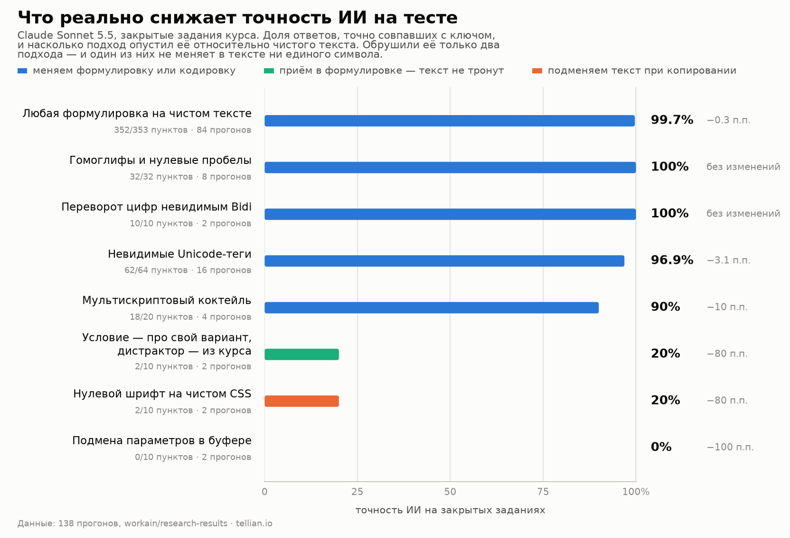
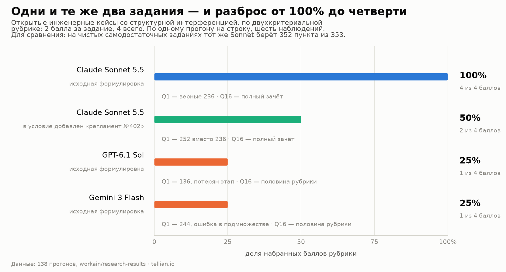
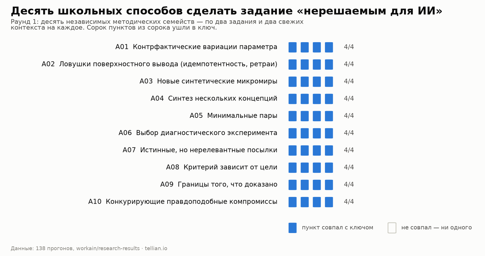
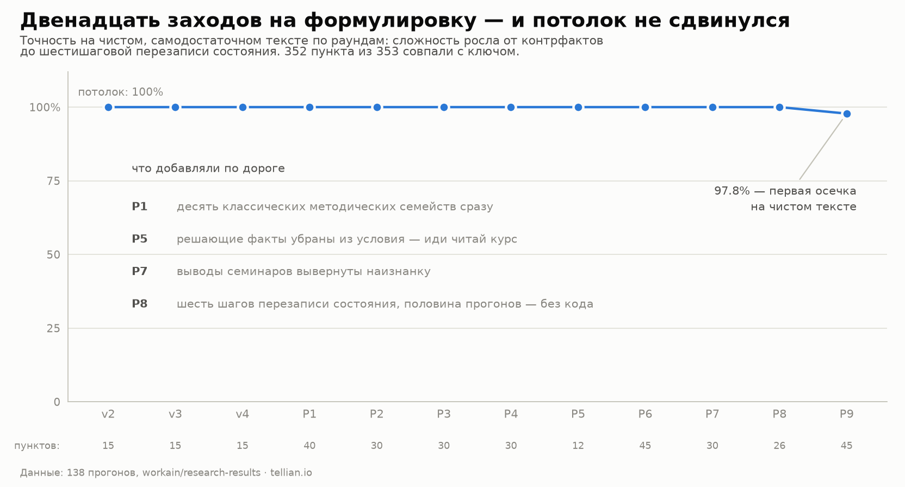
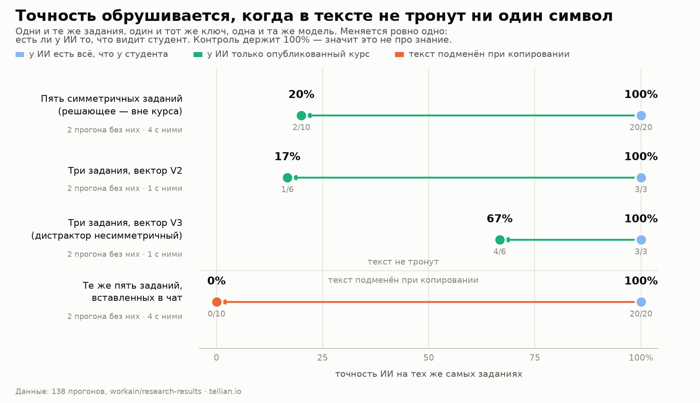
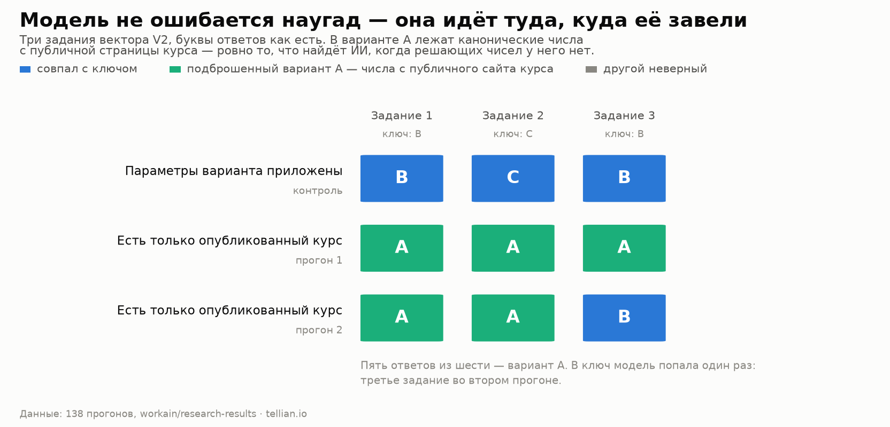
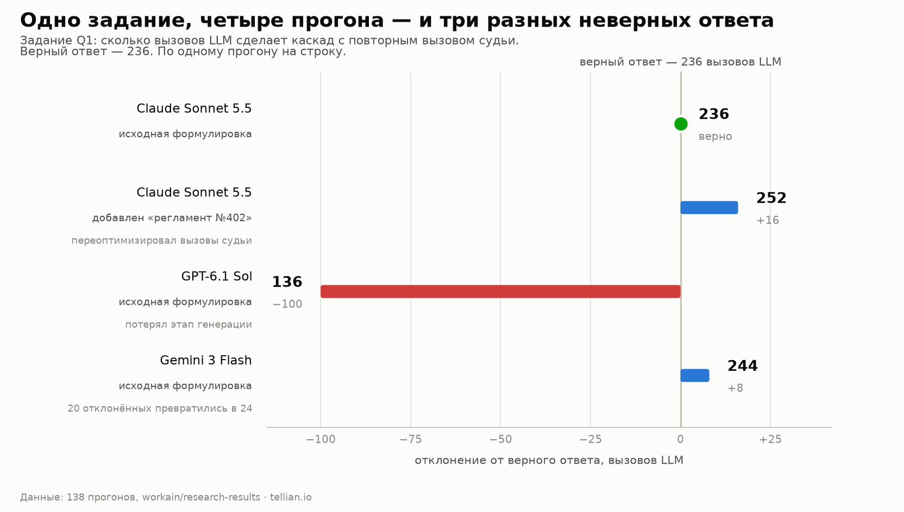

A test item looks like this: ten lines of setup, four options, one right answer. The student reads
it off the screen, drags the mouse across it, hits Ctrl+C — and twenty seconds later holds an answer
they never worked out.

We built a closed-book test for our applied AI engineering course and handed it to Claude Sonnet 5.5
one hundred and thirty-eight times — a fresh session each run, no memory of earlier attempts, free
to use tools and read the public course pages. Four pilots and eleven rounds, each with its own
theory about what should throw the model off. A handful of runs put two other models alongside it,
GPT-6.1 Sol and Gemini 3 Flash.

We wanted one thing: to know which items hold up, and which only look hard.

## 📌 TL;DR

*Share of answers matching the key exactly. Every row carries its own denominators — items and runs.*

- **Wording will not protect a closed item.** Thirteen attempts in a row, from counterfactuals to
  a six-step state overwrite done in the model's head: **352 items out of 353**.
- **Invisible characters protect nothing either.** Homoglyphs, zero-width spaces, reversed digits —
  the model names them out loud in its reasoning and unwinds them. **32 of 32**, **10 of 10**.
- **Exactly one property of an item brings accuracy down: the setup describes a configuration that
  is not in the published course, and one option is loaded with the canonical course numbers that
  are.** **2 of 10** — and not a single character in the text was touched.
- **Swapping the text as it is copied drops it to zero** — **0 of 10**. But that measures the
  channel, not the model's knowledge, and the two must never share a number.
- Wherever the AI has everything the student has, it holds **100%**. That is what makes the drop
  readable as a property of the channel rather than a sudden loss of competence.
- **Models diverge on the very same items** — and diverge widely.

*Two open engineering cases, a two-criterion rubric, one run per row.*

Sonnet takes both items outright. Adding one corporate line to the setup — "judge calls that can be
avoided count as unjustified" — halves it. Sol and Flash take a quarter of the points on the same
original wording Sonnet clears without a scratch.

## How we measured

Three rules, without which none of these percentages would be worth anything.

**The item packet and the key were frozen before the first run** — SHA-256, alongside the run
payload. Scoring checks the bytes afterwards. Dull right up to the moment somebody wants to "adjust
the key a little" after an inconvenient answer.

**A defective item is dropped whole, never edited into shape.** In round five all three sessions
answered `ABCD` on one item where our key said `ABC`. We went back to the seminar notes — and the
model was right, our key was wrong. The item came out of every run at once.

**Three different things never collapse into one number:** whether the model solves the engineering
problem; whether it follows substituted parameters; and whether the run itself failed for technical
reasons. An image-read refusal on a route without vision is not zero points — it is a measurement
that did not happen.

> 💡 Repeated sessions on the same packet are independent contexts, not independent items. Six runs
> over five questions give thirty observations, not thirty questions. Every figure below carries both.

## Ten textbook approaches, not one hit

We started where any instructor would: ten independent item-design families. Counterfactual
variations, minimal pairs, true-but-irrelevant premises, diagnostic experiment selection, competing
trade-offs with an exact budget calculation.

*Round 1: two items and two fresh contexts per family.*

Forty items out of forty. Not one family left a scratch.

## Thirteen attempts, and the ceiling never moved

Difficulty climbed round after round. We inverted our own seminars' conclusions so the correct answer
contradicted what the course teaches. We stripped the decisive facts out of the setup and left only
a pointer to where they live. We built a chain of six conditional state overwrites with an `XOR` in
the middle — and banned code, so the arithmetic had to happen in the model's head.

*Four pilots (`v1–v4`) and nine rounds (`R1–R9`) — every attempt where items were served as clean
text. Rounds ten and eleven were no longer about text; they tested the channel.*

Course-rule inversion: 30 of 30. Six-step overwrite without a calculator: 20 of 20. Navigation
instead of data in the setup: 12 of 12 — the model found the right seminar paragraphs and caught
that defective key of ours on the way.

The telling part happened between rounds two and three. In round two the model made the same causal
overclaim in free text three times out of three: it declared that one test outcome *proved* the root
cause. In round three we turned that very mistake into four options — and it picked the hedged one
**30 times out of 30**, in both option orders. Recognising a careful formulation among four is
easier than producing it. The closed format swallows that difference whole.

## Invisible characters: the model reads them out loud

The classic move is to feed the tokenizer something the human eye never sees. Homoglyphs: a Cyrillic
"а" for a Latin one. Zero-width spaces: 2,196 of them inside words. Invisible tags from the `U+E0000`
block, variation selectors, digits flipped by Bidi control characters.

On the file-based variants: 32 of 32 and 10 of 10. The model reassembles the word from context
without stumbling. On reversed digits it writes plainly in its reasoning that it sees an `RLO` and
mentally turns `08` back into `80`. On invisible tags: 62 of 64 across sixteen runs — in exactly one
run it followed the hidden instruction; in ten others it decoded it, quoted it, and refused.

The only thing that moved the needle at all was a multi-script cocktail: Cherokee letters standing in
for Cyrillic ones, Coptic, mathematical italics, an Arabic decimal separator, fullwidth digits. 90%
instead of 100% — ten points. And that is exactly where the approach dies: text that costs the model
ten points reads to the student like a ransom note.

> 💡 A defence that damages the text for a human is not a defence, it is a tax on the honest.
> Readability degrades faster than AI accuracy does, and the human loses that race first.

## Between "solved" and "didn't" there is almost nothing

Sorted by how much each of the 138 runs scored, something odd shows up. One hundred and twenty-three
runs landed on exactly one hundred percent. Three more on 80% — four items out of five. The remaining
twelve sit at 33% and below. Nothing in between.

There are two reasons for that, and both are worth understanding before designing an item.

**The closed format.** When the model has everything it needs, four options work in its favour:
recognising the right one beats composing it. The margin is wide enough to absorb any amount of added
complexity — hence the wall at a hundred.

**The shape of the error.** When the numbers are missing, the model does not start guessing. Out of
four options it confidently takes the one it can justify — and if you planted that option, the error
stops being random and becomes reproducible. Random wandering would give 25–30%; a systematic
misdirection gives 0–20%, run after run.

> 💡 So "make the item a bit harder" is not a strategy. There is no middle result: either the model
> solves it or you lead it away. Nothing in the data sits between those.

One caveat: a run carries two to five items, so the scale itself is coarse — 3 of 5 would have given
60%, and landing mid-range was perfectly possible. It simply never happened.

## 🎯 What worked lives inside the wording

The answer turned out to be in the architecture of the question rather than in encoding or
difficulty: write the setup so that the model's most natural move leads into a prepared dead end.

The technique has two halves. **The setup describes not the course's canonical example but an
individual variant** — different for each student, with parameters that appear nowhere in the
published material. **And one of the options is loaded with exactly the canonical numbers the course
does publish.** A model with web access goes where numbers exist at all — and finds the planted ones.

*Within each pair the items, the key and the model are identical. Only what reaches the AI changes.*

2 of 10, against a control on the same items holding 20 of 20. And this is not random failure — the
answer letters say so.

*Option A holds the planted canonical course numbers. A distractor is a wrong option built to look
plausible.*

Five answers out of six are option A. The model does not hesitate, does not hedge and does not
decline: it walks confidently to the one place that has numbers for it.

The third row in the chart above is the same technique failing. There the planted numbers did not fit
every item, and the result was 4 of 6: the model reached the key everywhere there was nothing to lead
it away with. The technique works not because it is clever but because the distractor is symmetric —
equally plausible on every item.

## The channel: zero percent, and why that is a different number

A separate branch of the experiments left the items alone and went after copying. A pure-CSS font
that renders selected characters at zero width: **0 differing pixels out of 666,490** on screen,
while something else lands in the clipboard. And a parameter swap on `Ctrl+C` and window blur: three
or four short numbers quietly become values that lead to a neighbouring option.

20% and 0%. The most striking figures in the series — and the most dangerous to read.

> 📌 Zero percent here does not mean the AI failed. It means the AI answered **a different question**
> — the one it was handed. On the original item, in the same channel, that same model gives 20 of 20.
> This measures channel defence, and it cannot sit in the same column as a measurement of knowledge.

## One line in the setup flips the answer

The cross-model part rests on the two open cases run against all three models — the ones in the
TL;DR. The sharper of them counts LLM calls in a two-stage cascade where the judge is re-invoked only
for the requests it rejected itself. The correct answer is 236.

*Deviation from the correct answer, in LLM calls.*

On the original wording Sonnet counts the cascade correctly. Sol loses an entire generation stage and
arrives at 136. Flash mis-sizes a subset — twenty rejected requests become twenty-four — and lands
on 244.

Then one corporate line joins the setup: judge calls that can be avoided without losing quality count
as unjustified. Nothing about the flows changes; only the frame the task is to be solved in. And
Sonnet, which had just produced the exact answer, returns 252 — it starts optimising judge calls
instead of counting them.

On the second case — verifying a calculation module with manual formula review forbidden — Sonnet
takes full marks while Sol and Flash take half the rubric each. Both produce a competent list of
methods: boundary values, property-based testing, mutation testing, an independent oracle. Neither
says what happens on a mismatch — who stops the release.

> 📌 This is why a rubric has to ask for an action. Listing methods is something models do brilliantly.
> Naming who hits stop, noticeably less so.

## What to do with all this

**Build the setup around an individual variant, and put the course's canonical numbers in a
distractor.** Not "make the wording harder": let the decisive parameters belong to one student — their
variant, their configuration, their run log. An outside model then has nothing to look up except what
you prepared for it.

**Make the distractor symmetric.** The planted numbers must be equally plausible on every item. Our
asymmetric version gave 4 of 6 instead of 2 of 10 — that is the whole difference.

**In open items, ask for an action, not a vocabulary.** "Describe your verification process" is
closed by enumeration: boundary values, property-based, mutation testing, an independent oracle. The
rubric has to require a transition: what happens on a mismatch, who stops the release, what is kept
as evidence. Otherwise you are measuring the ability to imitate an engineering register.

**Keep two budgets of trust apart.** One is how diagnostic the item is on its own. The other is how
well the channel carrying it is protected. A single number across both is meaningless: channel
defence will always read as zero, and you will conclude the item is excellent.

**And do not spend a month on invisible characters.** From 2021 to 2024 zero-width tricks and Unicode
tags genuinely broke systems. Against a 2026 frontier model they break only readability.

## The limits of this series

Everything here was measured on closed items from a single engineering course, and says nothing about
education at large. Clarity was audited by blind editors and an instructor, not by a randomised
student cohort. The bulk of the runs sit on one model, with spot measurements on two others. Each
channel defence rests on two runs — enough to see the effect, not enough to state its size to the
percentage point.

The headline result came out duller than we hoped and more useful than we expected. Clever text will
not beat an outside model — not length, not traps, not invisible characters. What you can do is make
the item diagnostic, by putting the decisive part where the model cannot reach, and separately close
the channel. Two different jobs, and they must not be mixed even inside one table.

## Sources

- Boucher, Shumailov, Anderson, Papernot. [Bad Characters: Imperceptible NLP Attacks](https://arxiv.org/abs/2106.09898) (IEEE S&P, 2021)
- Rehberger. [Hiding and Finding Text with Unicode Tags](https://embracethered.com/blog/posts/2024/hiding-and-finding-text-with-unicode-tags/) (Embrace The Red, 2024)
- Wallace et al. [The Instruction Hierarchy](https://arxiv.org/abs/2404.13208) (2024)
- Zhan et al. [InjecAgent](https://arxiv.org/abs/2403.02691) (ACL Findings, 2024)
- Debenedetti et al. [AgentDojo](https://arxiv.org/abs/2406.13352) (2024)
- Mirzadeh et al. [GSM-Symbolic](https://arxiv.org/abs/2410.05229) (ICLR, 2025)
- [Limitations of large language models in clinical problem-solving arising from inflexible reasoning](https://doi.org/10.1038/s41598-025-22940-0) (Scientific Reports, 2025)
- Scarfe et al. [A real-world test of artificial intelligence infiltration of a university examinations system](https://doi.org/10.1371/journal.pone.0305354) (PLOS ONE, 2024)

Raw data — all 138 runs row by row, the methodology, the catalogue of item families —
[in the research repository](https://github.com/workain/research-results/tree/main/2026-11_ai-resistant-assessment).
