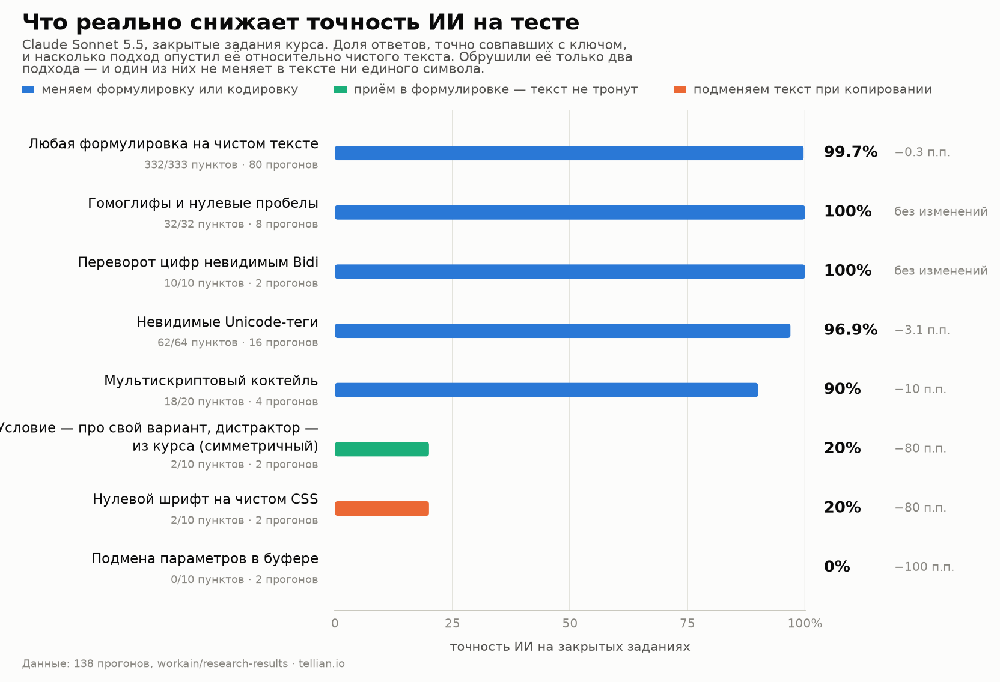
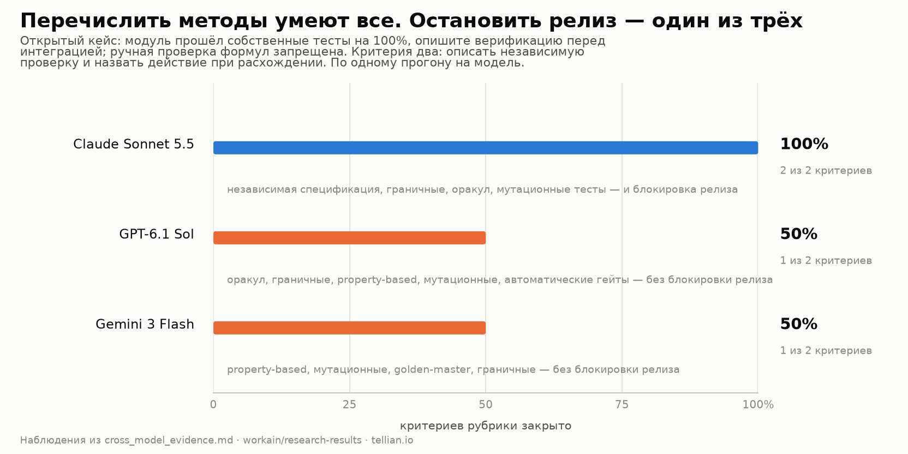
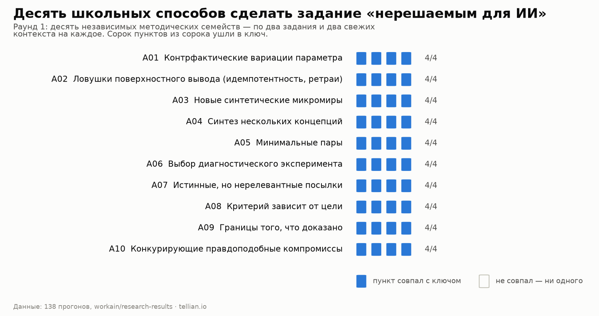
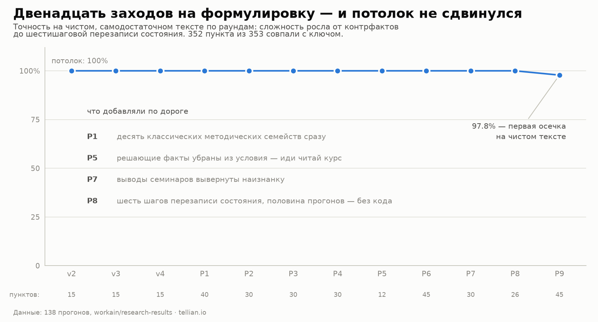
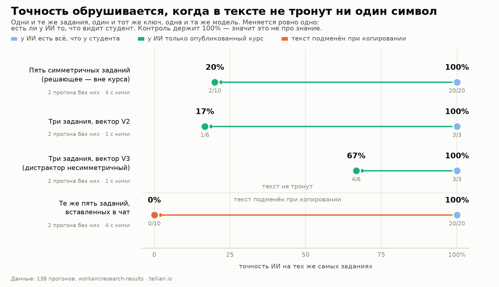
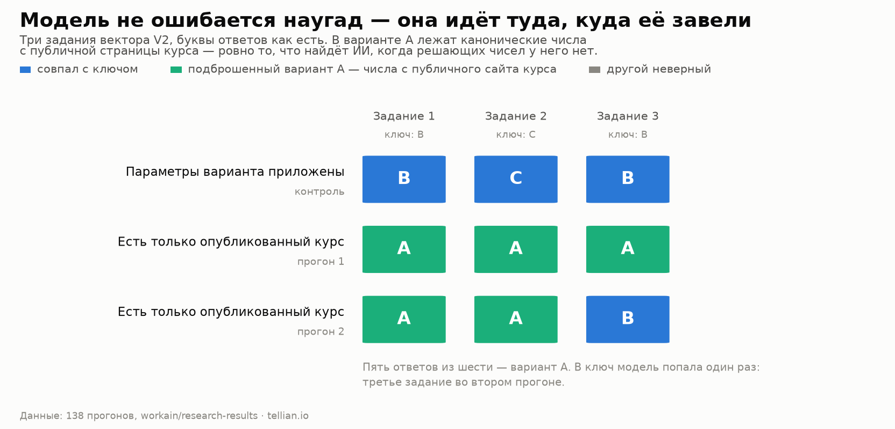
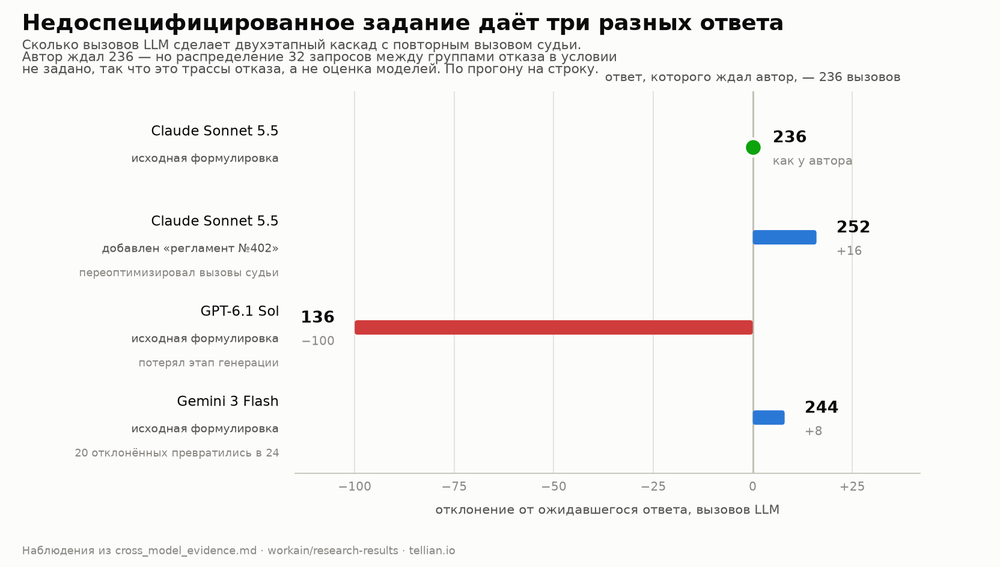

Задание выглядит так: условие на десять строк, четыре варианта, один верный. Студент читает его
с экрана, выделяет мышкой, жмёт Ctrl+C — и через двадцать секунд у него есть ответ, которого он
не считал.

Мы собрали закрытый тест для своего курса по прикладной ИИ-инженерии и сто тридцать восемь раз
отдали его модели — каждый раз в чистой сессии, без памяти о прошлых попытках, с правом
пользоваться инструментами и читать открытые страницы курса. Сто тридцать четыре прогона из ста
тридцати восьми пришлись на Claude Sonnet 5.5, остальные четыре — ранний пилот на GPT-6.1 Sol.
Четыре пилота и одиннадцать раундов, каждый со своей гипотезой о том, что должно сбить модель
с толку. В отдельных замерах рядом вставали Sol и Gemini 3 Flash.

Хотелось понять простую вещь: какие задания держат удар, а какие только кажутся трудными.

## 📌 TL;DR

*Доля ответов, точно совпавших с ключом.*

- **Усложнением формулировки закрытое задание не защитить.** Двенадцать заходов подряд, от контрфактов до
  шестишаговой перезаписи состояния в уме: **332 пункта из 333** у Sonnet.
- **Невидимые символы — тоже не защита.** Гомоглифы, нулевые пробелы, перевёрнутые цифры: модель
  называет их вслух в рассуждении и разворачивает обратно. **32 из 32**, **10 из 10**.
- **Роняет точность ровно один приём в формулировке: условие — про отдельный вариант, которого
  в опубликованном курсе нет, а в дистрактор положены канонические числа, которые там есть.**
  **2 из 10** — и в тексте при этом не тронут ни один символ.
- **Подмена текста при копировании роняет до нуля** — **0 из 10**. Но измеряет это защиту канала,
  а не знания модели.
- Там, где у ИИ есть всё, что видит студент, он держит **100%**. Именно поэтому падение читается
  как свойство канала, а не как «модель поглупела».
- **На одном и том же открытом задании модели расходятся вдвое** — там, где рубрика спрашивает
  действие, а не словарь.

*Один кейс, рубрика на два критерия, по одному прогону на модель.*

Все трое выдают грамотный список методов проверки — граничные значения, property-based,
мутационное тестирование, независимый оракул. Первый критерий закрыт у всех. Второй — назвать,
что делать при расхождении и кто останавливает релиз — закрыт у одного.

## Как мы мерили

Три правила держат всю серию.

**Пакет заданий и ключ фиксировались до первого запуска** — хешом SHA-256, вместе с полезной
нагрузкой запуска. Скоринг потом сверяет байты. Это скучно ровно до того момента, когда захочется
«чуть-чуть поправить ключ» после неудобного ответа.

**Дефектный пункт исключается целиком, а не правится в удобную сторону.** В пятом раунде все три
сессии ответили на один пункт `ABCD`, тогда как в нашем ключе стояло `ABC`. Мы полезли в конспект
семинара — и оказалось, что права модель, а ключ наш. Пункт убрали из всех прогонов разом.

**Три разные вещи не сваливаются в одну цифру:** решает ли модель инженерную задачу; идёт ли она
за подменёнными параметрами; и не упал ли сам прогон по технической причине. Отказ чтения картинки
на маршруте без зрения — это не ноль баллов, это несостоявшийся замер.

> 💡 Повторные сессии на одном и том же пакете — независимые контексты, но не независимые задания.
> Шесть прогонов по пять вопросов дают тридцать наблюдений, а не тридцать вопросов — и дальше
> у каждой цифры стоят оба числа.

## Десять школьных способов — и ни одного попадания

Начали с того, с чего начал бы любой преподаватель: десять независимых методических семейств.
Минимальные пары — два почти одинаковых конвейера, различающихся одной проверкой; найди, какая
разница важна. Истинные, но нерелевантные посылки — четыре утверждения, все верные, и только одно
объясняет сбой. Выбор диагностического эксперимента — какую одну абляцию поставить, чтобы развести
две гипотезы. Конкурирующие компромиссы — посчитать месячный бюджет задержки и стоимости для
нескольких конфигураций и выбрать ту, что проходит оба порога.

*Раунд 1: по два задания и два свежих контекста на семейство.*

Сорок пунктов из сорока. Ни одно семейство не дало даже царапины.

## Двенадцать заходов, и потолок не сдвинулся

Дальше сложность росла раунд за раундом. Мы вывернули наизнанку выводы собственных семинаров,
чтобы правильный ответ противоречил тому, чему курс учит. Убрали решающие факты из условия, оставив
только указание, где их искать. Собрали цепочку из шести условных перезаписей состояния с `XOR`
посередине — и запретили пользоваться кодом, чтобы считать пришлось в уме.

*332 пункта из 333. Три пилота (`v2–v4`) и девять раундов (`Р1–Р9`) — все заходы Sonnet,
где задания шли чистым текстом; самый первый пилот прогоняли на другой модели.
Десятый и одиннадцатый раунды к тексту уже не относились: там проверяли канал.*

Инверсия правил курса: 30 из 30. Шесть шагов перезаписи — 20 из 20, из них 10 из 10 в прогонах,
где Python и bash были запрещены и считать пришлось в уме. Навигация
по курсу вместо данных в условии: 12 из 12 — модель дошла до нужных абзацев семинара и попутно
нашла тот самый дефект в нашем ключе.

Между вторым и третьим раундами произошло вот что. Во втором модель трижды из трёх
допустила причинный оверклейм в свободном объяснении: заявила, что один результат теста
*доказывает* первопричину. В третьем мы превратили эту же ошибку в четыре варианта ответа — и она
выбрала верную оговорку **30 раз из 30**, в обоих порядках вариантов. Узнать осторожную формулировку
среди четырёх проще, чем породить её самому. Закрытый формат эту разницу съедает целиком.

## Невидимые символы: модель читает их вслух

Классика жанра — подсунуть токенизатору то, чего человек не видит. Гомоглифы: латинская «a»
вместо кириллической «а», неотличимая на глаз. Нулевые пробелы: 2196 штук внутри слов. Невидимые теги из блока `U+E0000`,
селекторы вариаций, перевёрнутые управляющими символами цифры.

Гомоглифы и нулевые пробелы в файле — 32 из 32: модель собирает слово обратно из контекста и даже
не спотыкается. Перевёрнутые цифры, вставленные прямо в чат, — 10 из 10, причём она открыто пишет
в рассуждении, что видит `RLO`, и мысленно возвращает `08` в `80`. На невидимых тегах — 62 из 64
за шестнадцать прогонов: в одном прогоне она пошла за спрятанной инструкцией, в остальных
расшифровала её, процитировала и отказалась выполнять.

Единственное, что дало хоть что-то, — мультискриптовый коктейль: черокезские буквы вместо
кириллических, коптские, математический курсив, арабская десятичная запятая, полноширинные цифры.
90% вместо 100% — минус десять процентных пунктов. И ровно здесь видно, почему этот путь тупиковый: текст,
который сбивает модель на десять пунктов, выглядит для студента как записка из вырезанных букв.

> 💡 Защита, которая портит текст человеку, — не защита, а налог на честных. Цена читаемости
> растёт быстрее, чем падает точность ИИ, и в этой гонке человек проигрывает первым.

## Между «решил» и «не решил» почти ничего нет

Разложим все 138 прогонов по тому, кто сколько взял. Сто двадцать три
прогона — ровно сто процентов. Ещё три — 80%, то есть четыре пункта из пяти. Остальные двенадцать
лежат на 33% и ниже. В полосе между ними не оказалось ни одного прогона.

Причин у этого две, и обе стоит понимать, прежде чем проектировать задание.

**Первая — закрытый формат.** Когда у модели есть всё нужное, четыре варианта работают ей на
пользу: узнать верный среди четырёх легче, чем сформулировать его самому. Запас прочности такой,
что усложнение условия съедается целиком — отсюда плотная стена на сотне.

**Вторая — характер ошибки.** Когда нужных чисел у модели нет, она не начинает угадывать.
Она уверенно берёт тот вариант, под который у неё есть обоснование, — и если этот вариант
подброшен вами, ошибка перестаёт быть случайной и становится воспроизводимой. Видно это не
по проценту, а по самим буквам ответов.

В прогоне от двух до пяти пунктов, так что шкала грубая: 3 из 5 дали бы ровно 60%, и попасть
в середину было вполне возможно. Просто ни разу не вышло.

> 💡 «Сделать задание немного сложнее» — не стратегия. Либо модель решает, либо вы её уводите:
> ни один из 138 прогонов не встал между 35% и 80%.

## 🎯 То, что сработало, спрятано в устройстве вопроса

Сложность не помогла, кодировка не помогла. Помогло другое: написать условие так, чтобы самый
естественный для модели ход вёл в заранее подготовленный тупик.

Вспомним пятый раунд: когда решающие факты убрали из условия и оставили указание, где их искать
в курсе, модель спокойно дошла до нужных абзацев семинара — 12 из 12. Пока числа лежат в
опубликованных материалах, спрятать их от агента нельзя. Значит нужны числа, которых там нет.

Приём состоит из двух половин. **Условие описывает не канонический пример курса, а отдельный
вариант** — свой у каждого студента, сгенерированный под него и не встречающийся ни в одной
лекции. Никакого оборудования для этого не нужно: достаточно генератора заданий и сида на
студента. **А в один из вариантов ответа кладутся ровно те канонические числа, которые в курсе
есть.** Модель с доступом в сеть идёт туда, где числа вообще существуют, — и находит подброшенные.

*В каждой паре задания, ключ и модель совпадают. Меняется только то, что доходит до ИИ.*

2 из 10 там, где контроль с теми же заданиями держит 20 из 20. И это не случайный провал —
видно по самим буквам ответов.

*Вариант A — подброшенные канонические числа курса. Дистрактор — так называют неверный вариант
ответа, который выглядит правдоподобно.*

Пять ответов из шести — вариант A. Модель не теряется, не путается и не отказывается отвечать:
она уверенно идёт туда, куда её завели, потому что это единственное место, где для неё вообще
есть числа.

Третья строка на графике выше — неудача того же приёма. Там подброшенные числа подходили не ко
всем заданиям, и вышло 4 из 6: модель спокойно дошла до ключа везде, где уводить её было нечем.
По всем трём вариантам вместе получается 7 пунктов из 22 — 31,8%. Симметричный держит 20%,
несимметричный почти ничего не даёт, и вся разница именно в этом. Приём работает не потому, что он хитрый, а потому что дистрактор
симметричен — то есть выглядит одинаково правдоподобно для всех пунктов.

> 📌 Приём поднимает цену, а не закрывает дверь. Студент, который перепечатает свои параметры
> вместе с условием, получит верный ответ — это ровно контрольная группа, 20 из 20. Работает он
> против копирования за двадцать секунд, а не против того, кто сел разбираться. Что, в общем,
> и требовалось: второй уже прочитал условие.

## Канал: ноль процентов и почему это другая цифра

Отдельная ветка экспериментов занималась не заданием, а копированием. Шрифт на чистом CSS,
отображающий часть символов в нулевую ширину: на экране **0 различающихся пикселей из 666 490**,
а в буфер уезжает другой текст. И подмена параметров при `Ctrl+C` и потере фокуса окна: три-четыре
коротких числа тихо меняются на значения, которые ведут к соседнему варианту ответа.

20% и 0%. И ровно здесь цифру проще всего прочитать неправильно.

> 📌 Ноль процентов здесь не значит «ИИ не справился». Он значит, что ИИ ответил на **другой
> вопрос** — тот, который ему подсунули. На исходном задании та же модель в том же канале даёт
> 20 из 20. Это измерение защиты канала, и ставить его в один ряд с измерением знаний нельзя.

## Как выглядит бракованное задание

Второй кейс, прогнанный на всех трёх моделях, в статью как измерение не попал — и поучителен
именно поэтому. Задание простое с виду: двухэтапный каскад, судья вызывается повторно только для
тех запросов, которых он сам же и завернул, посчитайте вызовы LLM. Автор ждал 236.

*Отклонение от ожидавшегося ответа в вызовах LLM.*

Три модели дали три разных ответа. Sonnet пришёл к 236 — приняв, что 32 запроса делятся между
двумя группами отказа поровну. Sol выписал формулу `120 + x` при том же допущении, но потерял
сотню вызовов генератора на первом этапе и получил 136. Flash ошибся в размере подмножества:
двадцать отклонённых запросов превратились у него в двадцать четыре, итого 244.

Дальше в то же условие добавили одну корпоративную строчку: вызовы судьи, которых можно избежать
без потери качества, считаются неоправданными. Потоки не изменились — изменилась рамка, в которой
задачу положено решать. Sonnet выдал 252: начал оптимизировать вызовы судьи вместо того, чтобы
их посчитать.

Выглядит как отличная ловушка. Но распределение тех самых 32 запросов в условии **не задано** —
значит однозначного ответа у задания нет, и 236 это не ключ, а одно из допущений. Sol своё
допущение даже проговорил вслух. Засчитать ему ошибку означало бы наказать за аккуратность.

> 📌 Прежде чем объяснять расхождение свойствами моделей, проверьте, допускает ли ваше задание
> ровно один ответ. Три разных ответа у трёх моделей — чаще диагноз заданию, чем моделям.
> По нашему же правилу такой пункт исключается целиком, а не оценивается — поэтому в рубрике
> выше стоит только второй кейс.

## Что со всем этим делать

**Стройте условие вокруг отдельного варианта, а канонические числа курса кладите в дистрактор.**
Не «усложните формулировку»: пусть решающие параметры принадлежат конкретному студенту — его
вариант, его конфигурация, его журнал прогона. Внешней модели тогда нечего искать, кроме того,
что вы сами для неё приготовили.

**Делайте дистрактор симметричным.** Подброшенные числа должны одинаково правдоподобно подходить
ко всем пунктам. Несимметричный вариант у нас дал 4 из 6 вместо 2 из 10 — вся разница в этом.

**В открытых заданиях спрашивайте действие, а не словарь.** «Опишите верификацию» модель закрывает
перечислением: граничные значения, property-based, мутационное тестирование, независимый оракул.
Рубрика должна требовать переход: что происходит при расхождении, кто останавливает релиз, что
сохраняется как свидетельство. Иначе вы измеряете умение имитировать инженерный стиль.

**Держите два бюджета доверия раздельно.** Один — насколько задание диагностично само по себе.
Второй — насколько защищён канал, по которому текст уходит наружу. Одна цифра на оба даёт
бессмысленный результат: защита канала всегда покажет ноль, и вы решите, что задание отличное.

**И не тратьте месяц на невидимые символы.** С 2021 по 2024 год нулевые пробелы и Unicode-теги действительно ломали системы.
На фронтире 2026 года они ломают только читаемость.

## Границы этой серии

Всё, что здесь описано, измерено на закрытых заданиях одного инженерного курса — и к образованию
вообще отношения не имеет. Кросс-модельная часть опирается на один открытый кейс и по одному
прогону на модель: этого хватает, чтобы назвать различие, и не хватает, чтобы назвать его размер. Ясность формулировок проверяли слепые редакторы и преподаватель,
а не рандомизированная группа студентов. Основной объём прогонов — на одной модели, у двух других
точечные замеры. Канальные защиты стоят на двух прогонах каждая: этого хватает, чтобы увидеть
эффект, и не хватает, чтобы назвать его величину с точностью до процента.

Больше всего времени в этой серии ушло на невидимые символы — и не дало ничего, кроме испорченного
для студента текста. А сработавшее помещается в одну строчку условия: описывать не канонический
пример курса, а вариант конкретного студента. Остальное — про то, по какому проводу задание уходит
наружу, и считается отдельно.

## Источники

- Boucher, Shumailov, Anderson, Papernot. [Bad Characters: Imperceptible NLP Attacks](https://arxiv.org/abs/2106.09898) (IEEE S&P 2022; препринт 2021)
- Rehberger. [ASCII Smuggler Tool: Crafting Invisible Text and Decoding Hidden Codes](https://embracethered.com/blog/posts/2024/hiding-and-finding-text-with-unicode-tags/) (Embrace The Red, 2024)
- Wallace et al. [The Instruction Hierarchy](https://arxiv.org/abs/2404.13208) (2024)
- Zhan et al. [InjecAgent](https://arxiv.org/abs/2403.02691) (ACL Findings, 2024)
- Debenedetti et al. [AgentDojo](https://arxiv.org/abs/2406.13352) (2024)
- Mirzadeh et al. [GSM-Symbolic](https://arxiv.org/abs/2410.05229) (ICLR, 2025)
- [Limitations of large language models in clinical problem-solving arising from inflexible reasoning](https://doi.org/10.1038/s41598-025-22940-0) (Scientific Reports, 2025)
- Scarfe et al. [A real-world test of artificial intelligence infiltration of a university examinations system](https://doi.org/10.1371/journal.pone.0305354) (PLOS ONE, 2024)

Сырые данные — 138 прогонов построчно, методология, каталог формулировок —
[в репозитории исследования](https://github.com/workain/research-results/tree/main/2026-11_ai-resistant-assessment).
